# Level 1 — System Context

> **Neo số liệu — đọc trước khi tin bất kỳ con số nào ở dưới.** File này được viết ngược từ mã
> nguồn thật tại commit `b559c68` (`main`, 2026-09-08), cùng một neo với `README.md` của bộ C4.
> Mọi đường dẫn, số file, số dòng và số lượng nêu trong file **thuộc cây đó**, không phải cây mới
> nhất. Ví dụ đã đo bằng `git ls-tree`: `docs/adr/` có **47** file `.md` tại `b559c68` và **50** tại
> `4af8932` (2026-11-10) — cả hai đều đúng, tại cây của mình. Nên hãy đọc các con số ở đây như một
> **ảnh chụp có ngày**, và muốn biết hiện trạng thì đo lại trên cây đang đứng.


> **Câu hỏi sơ đồ này trả lời:** 9Link là một hệ thống làm gì, **ai** dùng nó, và nó nói chuyện
> với **những hệ thống ngoài nào**. Không một chi tiết cài đặt nào xuất hiện ở đây.
>
> **Người đọc:** bất kỳ ai — kể cả không kỹ thuật. Nếu một người không đọc mã mà không hiểu được
> sơ đồ này, sơ đồ này sai.

---

## 1. Phạm vi hệ thống

Một **bản cài 9Link** (gọi là *instance*). Một instance có thể là:

- **9Link Cloud** — bản 9Link vận hành, có thư mục `ee/`, có bảng giá quảng cáo;
- **self-host OSS** — bản `git archive` loại `ee/`, AGPLv3, **luôn một cụm dữ liệu**;
- **self-host thương mại** — cây đầy đủ kèm giấy phép `/ee`.

Ba bản đó là **cùng một hệ thống** ở mức context; chúng khác nhau ở Level 2 trở xuống. Đây không
phải là sự đơn giản hoá tiện lợi — đó chính xác là điều seam open-core mua được (ADR 0029).

## 2. Sơ đồ

```mermaid
C4Context
  title Level 1 — System Context của một instance 9Link

  Person(visitor, "Người xem", "Vô danh. Bấm link rút gọn, quét QR, xem bio page, đi qua cổng quảng cáo, nhập mật khẩu link.")
  Person(publisher, "Chủ link (Publisher)", "Tạo và vận hành link, bio page, chiến dịch. Đọc analytics. Rút tiền kiếm được. Vai trò RBAC: owner/admin/member/viewer.")
  Person(developer, "Người tích hợp", "Gọi REST API bằng API key nlk_, dùng SDK, dựng workflow n8n/Zapier, nhận webhook ký HMAC.")
  Person(operator, "Người vận hành instance", "Cấp instance, không thuộc workspace nào. Duyệt lạm dụng, đặt bảng giá quảng cáo, duyệt chi trả, nạp doanh thu mạng.")
  Person(advertiser, "Nhà quảng cáo", "Mua ô hiển thị trên cổng của link (9Link Ads). Ở v1 được operator nạp qua CLI, chưa tự phục vụ.")

  System(nl, "9Link", "Nền tảng All-in-One for Link. Một URL thương hiệu, chín năng lực, mọi điểm chạm đổ về một lớp Event duy nhất.")

  System_Ext(dest, "Đích của link", "Website, deep link ứng dụng, wa.me, bio page. Nơi người xem được đưa tới.")
  System_Ext(stripe, "Stripe", "Subscription billing và Connect destination charge kèm application_fee.")
  System_Ext(gsb, "Google Safe Browsing v4", "Tra cứu URL độc hại lúc ghi. Tuỳ chọn: không có khoá thì hệ dùng blocklist nội bộ.")
  System_Ext(feeds, "Feed threat-intel công khai", "Nguồn blocklist nạp tự động theo chu kỳ.")
  System_Ext(doh, "Cloudflare DNS-over-HTTPS", "Tra bản ghi TXT 9link-verify để xác minh quyền sở hữu custom domain.")
  System_Ext(smtp, "Máy chủ SMTP", "Gửi mail xác minh, đặt lại mật khẩu, mời thành viên, cảnh báo quota, thông báo tiền.")
  System_Ext(llm, "Anthropic API", "Gợi ý tối ưu hoá theo yêu cầu. BYO key, fail-soft: không có key thì chỉ còn heuristic.")
  System_Ext(idp, "IdP doanh nghiệp (SAML 2.0)", "Cung cấp assertion đăng nhập một lần. Chỉ hoạt động khi có /ee.")
  System_Ext(adnet, "Mạng quảng cáo đối tác", "Tag quảng cáo bên thứ ba do chủ instance tự cấp (BYO), nhúng vào trang cổng.")
  System_Ext(gb, "GrowthBook", "Mặt phẳng phân tích thí nghiệm tuỳ chọn. CHỈ ĐỌC bảng events qua user gb_reader.")
  System_Ext(auto, "n8n / Zapier", "Nền tảng tự động hoá tiêu thụ webhook OUT và gọi REST API.")
  System_Ext(hook, "Endpoint webhook của khách", "URL https công khai do khách đăng ký, nhận delivery ký HMAC.")

  Rel(visitor, nl, "Bấm link, quét QR, xem bio, qua cổng quảng cáo, báo cáo lạm dụng", "HTTPS")
  Rel(nl, dest, "302 redirect, hoặc 200 interstitial deferred deep link", "HTTP")
  Rel(publisher, nl, "Đăng nhập, tạo và vận hành link, đọc số liệu, rút tiền", "HTTPS")
  Rel(developer, nl, "CRUD link/page/webhook, ghi conversion", "HTTPS + Bearer nlk_")
  Rel(operator, nl, "Duyệt lạm dụng, đặt bảng giá, duyệt chi trả", "HTTPS + CLI")
  Rel(advertiser, nl, "Đặt campaign và creative", "Gián tiếp qua operator ở v1")

  Rel(nl, stripe, "Tạo checkout session, destination charge", "HTTPS REST")
  Rel(stripe, nl, "Webhook đã ký: subscription, sale paid, account updated", "HTTPS")
  Rel(nl, gsb, "lookupWrite cho từng đích", "HTTPS")
  Rel(nl, feeds, "Tải danh sách chặn", "HTTPS")
  Rel(nl, doh, "Tra TXT record", "HTTPS")
  Rel(nl, smtp, "Gửi mail giao dịch", "SMTP")
  Rel(nl, llm, "Hỏi gợi ý, payload chỉ số tổng hợp, không PII", "HTTPS")
  Rel(idp, nl, "Assertion SAML qua /api/auth/sso", "HTTPS POST")
  Rel(nl, hook, "Delivery webhook ký HMAC-SHA256", "HTTPS POST")
  Rel(auto, nl, "Bắt webhook, gọi API", "HTTPS")
  Rel(gb, nl, "SELECT trên bảng events", "ClickHouse HTTP, chỉ đọc")

  UpdateLayoutConfig($c4ShapeInRow="4", $c4BoundaryInRow="1")
```



### Bản ASCII (đọc ở terminal / trong `git diff`)

```
                    ┌─────────────┐   ┌─────────────┐   ┌──────────────┐
                    │  Người xem  │   │  Chủ link   │   │Người tích hợp│
                    │ (vô danh)   │   │ (publisher) │   │ (developer)  │
                    └──────┬──────┘   └──────┬──────┘   └──────┬───────┘
             bấm/quét/xem │        dashboard │        REST nlk_│ + webhook
                    ┌─────▼─────────────────▼──────────────────▼──────┐
   ┌──────────────┐ │                                                 │ ┌───────────────┐
   │Người vận hành│─┤                   9 L I N K                     ├─│Nhà quảng cáo  │
   │  (operator)  │ │   một URL · chín năng lực · một lớp Event        │ │ (advertiser)  │
   └──────────────┘ │                                                 │ └───────────────┘
                    └───┬────┬────┬────┬────┬────┬────┬────┬────┬─────┘
                        │    │    │    │    │    │    │    │    │
                 302 ───┘    │    │    │    │    │    │    │    └─── SMTP: mail giao dịch
              ┌──────────┐   │    │    │    │    │    │    └──────── Anthropic (BYO, fail-soft)
              │ Đích link│   │    │    │    │    │    └───────────── GrowthBook (CHỈ ĐỌC events)
              │web/app/wa│   │    │    │    │    └────────────────── IdP SAML 2.0 (chỉ khi có /ee)
              └──────────┘   │    │    │    └─────────────────────── n8n/Zapier + endpoint webhook
                             │    │    └──────────────────────────── Cloudflare DoH (verify TXT)
                             │    └───────────────────────────────── Feed threat-intel công khai
                             └────────────────────────────────────── Google Safe Browsing (tuỳ chọn)
                                            Stripe ⇄ (REST + webhook đã ký)
```

## 3. Người dùng — nói rõ từng người một

### 3.1 Người xem (Visitor)

Người **duy nhất không có tài khoản** và cũng là người tạo ra gần như toàn bộ lưu lượng. Ba điều
về người này là ràng buộc thiết kế, không phải nhận xét:

| Ràng buộc | Hệ quả kiến trúc |
|---|---|
| Họ đang **đợi** | Đường 302 không được thêm một lượt I/O nào. Mọi tính năng mới phải chứng minh nó *zero-cost* khi tắt (bất biến §0.1/§0.3). |
| Họ **vô danh** | Không một cổng nào được phép phân biệt "cid chưa từng click" với "cid bị chặn vì trần chống gian lận" — đo bằng `GATE-ORACLE`, `GATE-REPLAY-ORACLE`. |
| Họ **không khiếu nại** | Một dương-tính-giả chống gian lận không giết link, nó chỉ khiến người đó không quay lại. Vì thế ADR 0043 **tách hai hệ quả**: ① người xem **luôn luôn** được phục vụ; ② chủ link chỉ được tính tiền khi mọi vế kiểm được và sạch. |

Người xem cũng là người **duy nhất tương tác với ba bề mặt công khai vô danh**: trang cổng quảng
cáo (CSP riêng), form mật khẩu link, `/report` (báo cáo lạm dụng không cần tài khoản), và
`/contact`. Mỗi bề mặt đó từng có một lỗ hổng thật được ghi lại trong `README.md` mục M18.

### 3.2 Chủ link (Publisher)

Một `User` thuộc một hoặc nhiều `Workspace` qua `Member`, với một trong bốn vai trò
(`apps/web/lib/authz/permissions.ts`):

| Vai trò | Ý nghĩa |
|---|---|
| `owner` | Toàn quyền, kể cả `settings.write` |
| `admin` | Như owner trừ những hành động được giữ riêng |
| `member` | Vận hành link/page hằng ngày |
| `viewer` | Chỉ đọc |

Từ mốc M36 (pivot 2026-08-25), chủ link đồng thời là **người kiếm tiền**: cổng quảng cáo bật mặc
định cho link **mới**, kèm công tắc tắt rõ ràng, và tiền về ví ở `/monetize`. Điều đó đổi bản
chất quan hệ: họ không chỉ là khách hàng, họ là **nhà cung cấp hàng tồn kho quảng cáo**. Vì vậy
họ có thêm hai bề mặt mà một SaaS thường không có: điều khoản người kiếm tiền
(`/legal/publisher-terms`) và hồ sơ nhận tiền (M40).

⚠️ Ràng buộc đứng trên tất cả, ghi trong `CLAUDE.md §3`: mặc định đó **chỉ áp khi instance thật
sự trả tiền cho publisher** (`currentRates() != null`). Không có bảng giá thì không được giữ chân
ai — xem `apps/web/lib/monetize/adgate/platform-default.ts`.

### 3.3 Người tích hợp (Developer)

Dùng **một hợp đồng REST duy nhất** được sinh từ một nguồn: Zod schema → OpenAPI 3.1
(`/api/openapi.json`) → `@ninelink/sdk` → node `n8n-nodes-9link`. Ba cổng
(`openapi-valid.test.ts`, `route-coverage.test.ts`, `spec-drift.test.ts`, `sdk-parity.test.ts`)
giữ bốn thứ đó không trôi khỏi nhau.

Xác thực bằng API key `nlk_…` theo workspace, lưu **SHA-256 không salt** (ADR 0002 — có lý do
được ghi trong ADR), token thô chỉ hiện đúng một lần, có scope và có hạn.

### 3.4 Người vận hành instance (Operator)

**Cấp instance, không thuộc workspace nào** — và đó là một quyết định có ADR (0035). Được xác
định bằng allowlist env `ABUSE_OPERATOR_EMAILS`; prod **từ chối boot** nếu một email trong
allowlist không ứng với user nào (lỗ hòm thư — xem `apps/web/instrumentation.ts`).

Bán kính hành động của người này là **toàn hệ thống**, nên mọi bề mặt của họ đều có
`frame-ancestors 'none'` và một số yêu cầu step-up:

| Bề mặt | Làm gì |
|---|---|
| `/govern/abuse` | Hàng chờ lạm dụng: giữ chặn / chặn cả host / gỡ chặn |
| `/govern/rates` | Bảng giá quảng cáo — **cấp CPM là nhận nghĩa vụ trả tiền** |
| `/govern/payouts` | Hàng chờ yêu cầu rút tiền |
| `pnpm ops:ads` | Nạp advertiser/campaign/creative (9Link Ads, `/ee`) |
| `pnpm ops:margin` | Nạp doanh thu mạng thật để đối soát biên |
| `pnpm ops:payout` | Duyệt/chi trả ngoài giao diện web |
| `pnpm blocklist` | Thêm/bớt mục chặn toàn cục — **không cần deploy** (ADR 0034) |
| `pnpm ops:reset-2fa` | Cứu một người khoá mình ngoài 2FA |

### 3.5 Nhà quảng cáo (Advertiser)

Người mua hàng tồn kho. Ở v1 **chưa có bề mặt tự phục vụ**: `ops:ads` là CLI do operator chạy.
Bốn bảng `Advertiser`/`AdCampaign`/`AdCreative`/`AdCampaignClick`/`AdCampaignCharge` nằm trong
`schema.prisma` (Core) nhưng **logic nằm ở `/ee`**, và có một cổng đo rằng không một dòng mã Core
nào đọc chúng (`GATE-ADS [A1]`).

## 4. Hệ thống ngoài — và điều gì xảy ra khi nó chết

Cột thứ ba là cột quan trọng nhất: một hệ ngoài không có chế độ hỏng được khai báo là một hệ
ngoài chưa được tích hợp.

| Hệ ngoài | Vai trò | Tuỳ chọn? | Chết thì sao (đo được) |
|---|---|---|---|
| **Stripe** | Billing subscription + Connect | Có | `getPaymentRail()` trả `null` ⇒ **fail-closed**: không bán gì, không ghi `earn` nào, nút nâng cấp tắt kèm lý do. Không có fallback tiền (ADR 0018). |
| **Google Safe Browsing** | Quét URL độc hại lúc ghi | Có (`GSB_API_KEY`) | `degraded=true` nghĩa là **"KHÔNG BIẾT" ≠ "sạch"** (M18). Không gỡ cờ `flagged` cũ, không kết luận, xếp lại lịch quét. |
| **Feed threat-intel** | Nguồn blocklist tự động | Có | Blocklist nội bộ + mục operator vẫn sống. `GATE-FEEDS` đo cả chiều âm: feed **không** được chặn URL sạch. |
| **Cloudflare DoH** | Verify TXT domain | Không (cho custom domain) | Verify trả `false` ⇒ domain ở trạng thái chưa xác minh ⇒ không tạo link trên đó. `DOMAIN_VERIFY_STUB` **bị bỏ qua ở prod** (fail-closed). |
| **SMTP** | Mail giao dịch | Có (`MAIL_SEND`) | Chế độ log cho dev. Ở prod thiếu cấu hình ⇒ mail không gửi; các luồng cần mail (verify, reset, invite, thông báo tiền) fail-soft hoặc fail-closed tuỳ loại — xem `lib/govern/mailer.ts`. |
| **Anthropic** | Gợi ý AI trụ 6 | Có (BYO) | **fail-soft**: `getLlm()` trả `null`, UI chỉ còn heuristic R1–R7 + một dòng ghi chú. Không nút chết, không trang trắng (ADR 0021). |
| **IdP SAML** | SSO doanh nghiệp | Có (`/ee`) | Bản OSS: registry **rỗng và đã seal** ⇒ nút SSO disabled, route SSO trả 404. Không ai chiếm được ổ sau boot. |
| **Mạng quảng cáo đối tác** | Tag bên thứ ba trong trang cổng | Có | Ổ cắm có chủ thì **chủ giữ ổ kể cả khi trả `null`** — nếu không, publisher chưa cấu hình sẽ bị phục vụ bằng tag trong env của chính instance, doanh thu về túi ta, không một dòng sổ. |
| **GrowthBook** | Phân tích thí nghiệm | Có, profile compose riêng | Không ảnh hưởng đường phục vụ: GB **chỉ đọc** qua user `gb_reader` với đúng một quyền `GRANT SELECT`. Cấm nhúng iframe vào dashboard, cấm phơi cho tenant. |
| **Endpoint webhook khách** | Nhận sự kiện | — | Retry theo lịch ZSET `webhooks:retry`; endpoint failing **tự tắt** sau ngưỡng. Delivery là **best-effort**: nguồn sự thật là Postgres + REST, webhook chỉ là tín hiệu (ADR 0019). |
| **n8n / Zapier** | Tự động hoá | — | Không có gì trong đường phục vụ phụ thuộc chúng. App Zapier chính thức đã **gỡ** (2026-08-03) vì ToS độc quyền; đường còn lại là Catch Raw Hook. |

⚠️ **Không có hệ ngoài nào nằm trên đường nóng 302.** Đó không phải trùng hợp mà là luật
(bất biến §2 của `CLAUDE.md`): *"Đừng để việc ghi analytics làm chậm cú 302"*. Kiểm chứng bằng
cách đọc `apps/web/app/[key]/route.ts` — mọi lời gọi hệ ngoài đều nằm trong `after()` hoặc ở
đường ghi.

## 5. Những ai **không** phải người dùng của hệ thống này

Ghi ra để sơ đồ không bị đọc rộng hơn mã (luật §16.2 của văn hoá repo):

- **Người mua hàng trên bio page** — họ là *người xem* của 9Link và là *khách* của chủ link. 9Link
  không bao giờ tự khẳng định có tiền: một `MonetizeSale` chỉ chuyển `paid` từ webhook Stripe đã
  verify chữ ký (ADR 0017/0018).
- **Người nhận tiền chi trả** — v1 dừng ở trạng thái `approved`; **chuyển tiền diễn ra ngoài hệ**,
  có chủ ý (ADR 0043 §"Chưa làm, cố ý"). Không có tích hợp ngân hàng/ví điện tử nào trong cây mã.
- **End-user của tenant trên GrowthBook** — `gb_reader` đọc **xuyên workspace**, nên GrowthBook là
  công cụ của người vận hành instance, cấm phơi cho tenant.
