# Level 2 — Container

> **Neo số liệu — đọc trước khi tin bất kỳ con số nào ở dưới.** File này được viết ngược từ mã
> nguồn thật tại commit `b559c68` (`main`, 2026-09-08), cùng một neo với `README.md` của bộ C4.
> Mọi đường dẫn, số file, số dòng và số lượng nêu trong file **thuộc cây đó**, không phải cây mới
> nhất. Ví dụ đã đo bằng `git ls-tree`: `docs/adr/` có **47** file `.md` tại `b559c68` và **50** tại
> `4af8932` (2026-11-10) — cả hai đều đúng, tại cây của mình. Nên hãy đọc các con số ở đây như một
> **ảnh chụp có ngày**, và muốn biết hiện trạng thì đo lại trên cây đang đứng.


> **Câu hỏi sơ đồ này trả lời:** hệ thống 9Link được tạo bởi **những tiến trình và kho dữ liệu
> nào**, công nghệ của từng cái, và chúng nói chuyện với nhau bằng giao thức gì.
>
> **Người đọc:** kỹ sư mới vào repo · người vận hành · kiến trúc sư đánh giá self-host.
>
> **Quy tắc mức này:** một *container* = một thứ **chạy được hoặc lưu trữ được** độc lập. Thư mục
> `apps/web/lib/monetize` không phải container; tiến trình `node apps/web/dist/worker.cjs` là
> container.

---

## 1. Sơ đồ container

```mermaid
C4Container
  title Level 2 — Container của một instance 9Link

  Person(visitor, "Người xem", "Vô danh")
  Person(publisher, "Chủ link", "Dashboard")
  Person(developer, "Người tích hợp", "REST + webhook")
  Person(operator, "Người vận hành", "Cấp instance")

  System_Boundary(nl, "9Link — một instance") {

    Container(proxy, "Reverse proxy / TLS", "Caddy (deploy) · Cloudflare (đích)", "Chấm TLS, đặt header edge, không chứa logic sản phẩm.")

    Container(web, "9Link Web", "Next.js 15 App Router · React 19 · Node 22 · TypeScript strict", "apps/web — MỘT tiến trình, BỐN nhóm route: công khai + dashboard + REST API + đường phục vụ link.")

    Container(worker, "9Link Worker", "Node 22 · bundle esbuild worker.cjs · cùng image với web", "apps/web/worker — BA loop song song: ingest Event, delivery webhook, job nền.")

    Container(ops, "9Link Ops CLI", "tsx · chạy theo yêu cầu, không thường trú", "apps/web/scripts + ee/scripts + packages/db/scripts — ứng cứu sự cố không cần deploy.")

    ContainerDb(pg, "Postgres — mặt phẳng cấu hình", "PostgreSQL 16 · Prisma · 34 model · 55 migration", "Link, Page, Workspace, User, Member, Domain, ApiKey, AuditLog, Blocklist, AbuseCase, sổ tiền (AdEarning, PayoutRequest, AdRateCard), nhịp tim job.")

    ContainerDb(ch, "ClickHouse — mặt phẳng sự kiện", "ClickHouse 24.8 · MergeTree · append-only", "ĐÚNG MỘT bảng events cho MỌI loại: click, scan, view, convert, earn, impression. Đây là moat, không phải feature.")

    ContainerDb(redis, "Redis", "Redis 7 (bắt buộc ≥ 6.2 vì XAUTOCLAIM)", "Bốn vai trò: cache link/page (TTL 60s), rate-limit, click-limit, và HAI stream (events, webhook deliveries).")

    ContainerDb(directory, "Region directory", "Postgres · MỘT bảng · ngoài schema.prisma", "Chỉ tồn tại ở residency mức 3. Trả lời đúng một câu: email này thuộc vùng nào. Khoá là HMAC có khoá, không phải email.")
  }

  System_Ext(stripe, "Stripe", "Billing + Connect")
  System_Ext(safety, "Nguồn an toàn URL", "Google Safe Browsing + blocklist feed")
  System_Ext(mail, "Máy chủ SMTP", "Mail giao dịch")
  System_Ext(llm, "Anthropic", "Gợi ý AI, BYO")
  System_Ext(idp, "IdP SAML", "Chỉ khi có /ee")
  System_Ext(gb, "GrowthBook", "Tuỳ chọn, CHỈ ĐỌC")
  System_Ext(auto, "n8n / Zapier", "Tự động hoá")
  System_Ext(hook, "Endpoint webhook khách", "HTTPS công khai")
  System_Ext(dest, "Đích của link", "Web / app / wa.me")

  Rel(visitor, proxy, "Bấm link, quét QR, xem bio, qua cổng", "HTTPS")
  Rel(publisher, proxy, "Dashboard", "HTTPS")
  Rel(developer, proxy, "REST API", "HTTPS + Bearer nlk_")
  Rel(operator, proxy, "Bề mặt /govern/*", "HTTPS")
  Rel(operator, ops, "Chạy lệnh ứng cứu", "shell")
  Rel(proxy, web, "Proxy tới cổng 3000", "HTTP")

  Rel(web, pg, "Đọc/ghi cấu hình, CAS trên links.version", "Prisma / TCP 5432")
  Rel(web, ch, "Truy vấn analytics, fan-out theo span residency", "ClickHouse HTTP 8123")
  Rel(web, redis, "Cache link/page, rate-limit, click-limit INCR", "RESP")
  Rel(web, redis, "XADD events:stream:<cluster> và webhooks:deliveries", "RESP, trong after()")

  Rel(worker, redis, "XREADGROUP / XACK / XAUTOCLAIM / ZADD retry", "RESP, kết nối BLOCK riêng cho mỗi loop")
  Rel(worker, ch, "INSERT lô JSONEachRow vào ĐÚNG CỤM", "ClickHouse HTTP")
  Rel(worker, pg, "Lịch quét lại, nhịp tim job, kết sổ tiền, quét trần lưu lượng", "Prisma")

  Rel(ops, pg, "Blocklist, nạp doanh thu mạng, duyệt chi trả, nạp kho quảng cáo", "Prisma")
  Rel(ops, ch, "Đối soát số lượt", "ClickHouse HTTP")
  Rel(ops, redis, "Dọn hàng đợi, kiểm unrouted", "RESP")

  Rel(web, stripe, "Checkout session, destination charge", "HTTPS REST, pin api-version")
  Rel(stripe, web, "POST /api/stripe/webhook đã ký", "HTTPS")
  Rel(web, safety, "lookupWrite lúc ghi, tải feed theo chu kỳ", "HTTPS")
  Rel(web, mail, "Gửi mail", "SMTP qua nodemailer")
  Rel(web, llm, "Gợi ý on-demand", "HTTPS REST, không SDK")
  Rel(idp, web, "Assertion SAML vào /api/auth/sso/[provider]/acs", "HTTPS POST")
  Rel(worker, hook, "POST ký HMAC-SHA256, header 9link-signature", "HTTPS")
  Rel(auto, web, "Bắt webhook, gọi REST", "HTTPS")
  Rel(gb, ch, "SELECT trên events bằng user gb_reader", "ClickHouse HTTP, đúng một quyền SELECT")
  Rel(web, dest, "302 Location, hoặc 200 interstitial", "HTTP")

  UpdateLayoutConfig($c4ShapeInRow="3", $c4BoundaryInRow="1")
```



### Bản ASCII

```
        người xem · chủ link · người tích hợp · operator
                              │ HTTPS
                     ┌────────▼─────────┐
                     │ Reverse proxy/TLS│  Caddy (deploy) · Cloudflare (đích)
                     └────────┬─────────┘
                              │ :3000
   ┌──────────────────────────▼──────────────────────────────────────────┐
   │                     9Link Web  (Next.js 15)                         │
   │  công khai · dashboard · REST /api/* · đường phục vụ /[key]         │
   └───┬───────────────┬───────────────┬─────────────────────┬───────────┘
       │ Prisma        │ HTTP 8123     │ RESP                │ HTTPS
       │               │               │ cache · limit       │ Stripe · GSB · DoH
       │               │               │ XADD (after())      │ SMTP · Anthropic · IdP
       │               │               │                     │
   ┌───▼────┐    ┌─────▼──────┐   ┌────▼─────┐               │
   │Postgres│    │ ClickHouse │   │  Redis   │               │
   │config  │    │ events     │   │cache+queue│              │
   │34 model│    │(append-only)│  │+limits   │               │
   └───▲────┘    └─────▲──────┘   └────▲─────┘               │
       │               │ INSERT lô     │ XREADGROUP/XACK      │
       │               │ đúng cụm      │ XAUTOCLAIM           │
   ┌───┴───────────────┴───────────────┴──────┐               │
   │        9Link Worker  (3 loop)            │───────────────┼──▶ endpoint webhook
   │  ① ingest Event ② delivery webhook       │  POST ký HMAC │    (retry ZSET)
   │  ③ job nền: rescan · feeds · serve-sweep │               │
   │     settle tiền · đối soát biên · tim    │               │
   └──────────────────────────────────────────┘               │
                                                              │
   ┌──────────────────────────────┐                           │
   │ 9Link Ops CLI (không thường trú)│──▶ Postgres · ClickHouse · Redis
   │ blocklist · ops:ads · ops:margin│
   │ ops:payout · rotate-auth-secret │
   └──────────────────────────────┘

   Tuỳ chọn, NGOÀI đường phục vụ:  GrowthBook ──SELECT chỉ-đọc──▶ ClickHouse
                                   n8n / Zapier ──▶ REST + webhook
```

## 2. Bảng container

| Container | Công nghệ | Mã nguồn | Số lượng trong một instance |
|---|---|---|---|
| **9Link Web** | Next.js 15 (output `standalone`) · React 19 · Node 22 · TypeScript `strict` + `noUncheckedIndexedAccess` | `apps/web/app/**`, `apps/web/lib/**`, `ee/**` (khi có) | 1..n (nhân bản ngang được; `web` không giữ trạng thái ngoài cookie/cache) |
| **9Link Worker** | Node 22, bundle `esbuild` → `dist/worker.cjs`, **cùng image với web** | `apps/web/worker/index.ts` (876 dòng, 3 loop) | 1..n (an toàn theo cấu trúc: consumer name = `worker-<pid>` + `XAUTOCLAIM` theo `minIdle`) |
| **9Link Ops CLI** | `tsx` + `dotenv-cli`, chạy rồi thoát | `apps/web/scripts/**`, `ee/scripts/**`, `packages/db/scripts/**` | theo yêu cầu |
| **Postgres** | PostgreSQL 16 · Prisma Client | `packages/db/prisma/schema.prisma` | **1..N cụm** (residency mức 3, ADR 0047) |
| **ClickHouse** | ClickHouse 24.8 · engine `MergeTree` · `PARTITION BY toYYYYMM(ts)` · `ORDER BY (workspace_id, link_id, ts)` | `apps/web/lib/clickhouse.ts` (DDL là nguồn sự thật) | **1..N cụm** (residency mức 2, ADR 0036–0039) |
| **Redis** | Redis 7 (`ioredis`) | `apps/web/lib/redis.ts` | 1 — ⚠️ **dùng chung** cho cache + rate-limit + stream; một sự cố residency phình stream `unrouted` sẽ kéo sập lá chắn chống abuse, nên stream đó có `MAXLEN` |
| **Region directory** | Postgres, **một bảng**, cố ý **không** nằm trong `schema.prisma` | `packages/db/directory/001_region_directory.sql` | 0 hoặc 1 (chỉ residency mức 3) |
| Reverse proxy | Caddy (`deploy/`) | `deploy/docker-compose.yml`, mạng `edge` external | 1 |
| GrowthBook *(tuỳ chọn)* | Docker profile `growthbook` + MongoDB riêng | `infra/growthbook/**` | 0 hoặc 1 |
| n8n *(tuỳ chọn)* | Bên ngoài repo | `docs/connect/n8n-webhook-template.json` | 0 hoặc 1 |

### Không phải container, nhưng là sản phẩm phân phối

| Gói | Loại | Ghi chú |
|---|---|---|
| `@ninelink/sdk` | Thư viện TypeScript, **zero-dependency** | `packages/sdk` — `generated.ts` sinh từ OpenAPI bằng `scripts/gen-from-openapi.mjs`; có `signature.ts` để verify webhook |
| `n8n-nodes-9link` | Gói node n8n | `packages/n8n-nodes-9link` — `NineLink.node.ts` + `NineLinkTrigger.node.ts` + credentials |
| `@ninelink/db` | Gói Prisma trong workspace | `packages/db` — ship **TS source**, Next transpile |

## 3. Bốn nhóm route bên trong container Web

Một tiến trình, bốn bản chất rất khác nhau. Tách bằng **route group** của App Router (ADR 0025),
và sự tách biệt đó được gác bằng máy (`app/chrome-boundary.test.ts`, `app/landing-public.test.ts`).

| Nhóm | Đường dẫn | Bản chất | Ràng buộc riêng |
|---|---|---|---|
| **Đường phục vụ link** | `/{key}` · `/r/{code}` · `/ac/{token}` · `/pay/{pageId}/{blockIndex}` · `/pay/success` | Vô danh, khối lượng lớn, đang đợi | **Zero I/O mới trước 302.** `dynamic = "force-dynamic"`, `Cache-Control: no-store`. Không middleware, không i18n URL-routing (ADR 0014). |
| **Công khai** | `/` · `/pricing` · `/docs` · `/security` · `/open-source` · `/contact` · `/report` · `/legal/publisher-terms` | Vô danh, có form | `frame-ancestors 'none'` từng source **exact-match** — tuyệt đối không `/:path*` vì pattern sẽ nuốt `/{key}` |
| **Auth** | `/login` · `/login/2fa` · `/signup` · `/forgot-password` · `/reset-password` · `/verify-email` · `/invite/[token]` · `/api/auth/**` | Vô danh → có danh tính | Rate-limit fail-closed cho `login:`/`api-keys:` (cửa sổ trượt); `Referrer-Policy` quan trọng riêng cho hai route mang token trong URL |
| **Dashboard** | `(app)`: `/create` `/enrich`* `/route`* `/publish` `/measure` `/optimize` `/monetize` `/govern/**` `/connect` `/domains` `/keys` `/settings` | Có danh tính, RBAC | Mutation qua **server action** (ADR 0004), không REST nội bộ. `react-query` cho đọc. |
| **REST API** | `/api/links/**` `/api/pages/**` `/api/webhooks/**` `/api/keys/**` `/api/track/convert*` `/api/monetize/**` `/api/contact` `/api/report` `/api/health/**` `/api/openapi.json` `/api/stripe/webhook` | Có danh tính (API key) hoặc vô danh (convert/report/contact) | Zod ở biên. Trần byte thật **trước** khi parse (`lib/api/body.ts`). OpenAPI là hợp đồng công khai. |

\* `/enrich` và `/route` là **panel trong trang chi tiết link**, không phải route App Router riêng
— xem `apps/web/app/enrich/` và `apps/web/app/route/` cho các component panel.

## 4. Ba loop của container Worker

`apps/web/worker/index.ts` chạy **ba loop song song** trong một tiến trình, mỗi loop blocking có
**kết nối Redis riêng** (`redis.duplicate()`) vì `XREADGROUP BLOCK` giữ chết kết nối — hai loop
chung một kết nối sẽ chặn lẫn nhau.

| Loop | Đọc | Ghi | Bảo đảm |
|---|---|---|---|
| **① Ingest Event** | `events:stream` (một cụm) hoặc `events:stream:<clusterId>` (đa cụm), group `ch-writers` | `INSERT` lô `JSONEachRow` vào ClickHouse → `XACK` | **at-least-once**; một event hỏng không giết cả lô — cách ly poison qua `lib/events-ingest.ts` → dead-letter `events:dead` |
| **② Delivery webhook** | `webhooks:deliveries`, group riêng, `XAUTOCLAIM` theo `minIdle` | `POST` ký HMAC tới endpoint khách; retry ZSET `webhooks:retry`; tự tắt endpoint failing | **at-least-once thật** (đòi Redis ≥ 6.2); consumer name = PID để tránh double-send có hệ thống |
| **③ Job nền** | Lịch ở **Postgres** (`nextScanAt`), nhịp ở `JobHeartbeat` | Quét lại an toàn · đồng bộ feed · quét trần lưu lượng · **kết sổ tiền quảng cáo** · đối soát biên · xoá IP người báo cáo · ghi nhịp tim | Mỗi job có **cửa sổ chu kỳ thật** và nhịp tim; readiness đọc nhịp tim để biết job còn sống (ADR 0042) |

**Điều quan trọng nhất về loop ③:** nó là chỗ **tiền được sinh ra**. `settleAdEarningsThrottled`
đọc `events` (ClickHouse) → tính `floor(impressions × cpmMinor / 1000)` → `upsert` vào
`ad_earnings` (Postgres) theo **khoá tự nhiên 5 cột** ⇒ chạy lại không nhân đôi tiền. Và nó chạy
trong worker của **Core** dù giá đến từ `/ee` — được, vì Core chỉ hỏi ổ cắm `AdNetwork.rates()`
(ADR 0043 §6).

## 5. Kiến trúc đích vs hiện trạng — nói thẳng

`docs/ARCHITECTURE.md` và `CLAUDE.md §1` mô tả lớp EDGE là **Cloudflare Workers tại PoP US/UAE/EU,
mục tiêu <50ms**. Đây là **kiến trúc đích**, không phải hiện trạng của cây mã:

| | Đích đã viết | Hiện trạng đo được trong cây |
|---|---|---|
| Nơi chạy đường 302 | Cloudflare Workers, PoP US/UAE/EU | **Next.js route handler** `apps/web/app/[key]/route.ts`, `dynamic = "force-dynamic"`, đứng sau reverse proxy |
| `CLOUDFLARE_ACCOUNT_ID` / `CLOUDFLARE_API_TOKEN` | — | Có trong `.env.example`, **0 tham chiếu trong mã** — chưa được dùng |
| Đa PoP theo vùng | Edge chọn cụm theo `workspace.region` | Event **ghi** theo cụm (M19, đã thật). Edge **phục vụ** vẫn một nơi; prod hôm nay **một cụm** |
| `TRUST_EDGE_IP_HEADER=cf` | — | Có cơ chế đọc header edge; `deploy/.env` đang đặt `off` ⇒ `adGateVisitorCountry` trả `XX` cho **mọi** người xem ⇒ mọi campaign có khai `countries` sẽ **không bao giờ phục vụ** (ghi rõ trong `ee/ads/model.ts`) |

**Vì sao vẫn đúng lời hứa kiến trúc:** điều bất biến §0.1/§0.3 thật sự đòi không phải "chạy trên
Workers" mà là *"đường 302 không thêm một lượt I/O nào cho mỗi tính năng mới"*. Lời hứa đó **đang
được giữ và được đo**: mọi ngoại lệ kéo dữ liệu vào `resolveLink.select` đều có ADR riêng
(0006 routing · 0008 trackConversion · 0016 pageId · M18 quarantined · M22 serveBlocked ·
M24 adGate), và mỗi mốc đóng kèm một phép đo "302 byte-identical mốc trước".

Chuyển đường phục vụ sang Workers là một **quyết định chưa được đưa ra**, và nó sẽ phải trả lời
một câu khó được ghi sẵn trong ADR 0006: toàn bộ rule engine, PBKDF2 verify, HMAC token và bộ
render HTML tự-chứa hiện đang chạy trong runtime Node.

## 6. Những gì **cố ý không có** ở mức container

Mỗi dòng dưới đây là một thứ mà một hệ thống cùng loại thường có, và 9Link không có — có lý do:

| Không có | Vì sao |
|---|---|
| **Message broker riêng** (Kafka/RabbitMQ/SQS) | Redis Stream đã đủ cho hai hàng đợi hiện có, và thêm một broker là thêm một nơi Event có thể bị mất. Bất biến §0.2: **một** lớp dữ liệu. |
| **Object storage** (S3/R2) | Không có upload nào trong sản phẩm: block bio bị cap 30 block / 16KB, **cấm custom HTML**, QR logo là data-URL. Bỏ storage là bỏ cả một lớp lỗ hổng. |
| **Service analytics riêng** | Analytics là các hàm truy vấn ClickHouse trong `lib/analytics.ts` của cùng container web. Tách ra sẽ tạo một nơi thứ hai định nghĩa "trial/success" — đúng thứ ADR 0024 mua bằng hợp đồng SQL có test. |
| **Cache CDN cho redirect** | `Cache-Control: no-store` trên **mọi** phản hồi của đường phục vụ. Một proxy giữ lại 302 nghĩa là cú bấm thứ hai không đếm được và một creative đã `kill` vẫn đẩy người thật tới đích cũ (ghi trong `app/ac/[token]/route.ts`). |
| **Hai datasource Prisma** (một cho `/ee`) | Sẽ mua một ranh giới hình thức bằng một làn migration thứ hai + một cơ chế drift thứ hai (`docs/M37-PLAN.md` QĐ-1). Ranh giới open-core là **chiều import**, không phải "chữ nào xuất hiện trong gói nào". |
| **Tiến trình scheduler riêng** (cron) | Job nền sống trong worker, **lịch ở Postgres** chứ không phải Redis ZSET — vì `FLUSHDB`/eviction làm việc quét ngừng **im lặng** (bài học M18/T18.4). |
