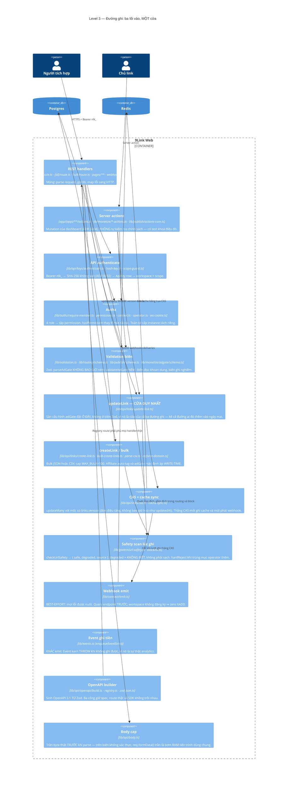
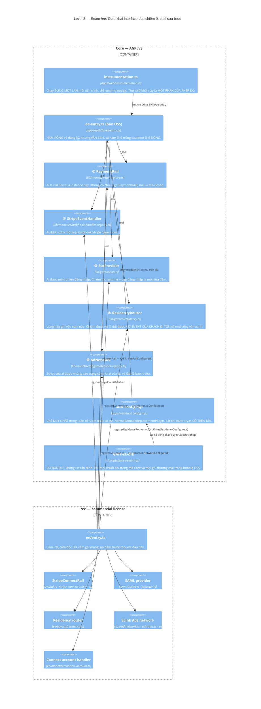

# Level 3 — Component

> **Neo số liệu — đọc trước khi tin bất kỳ con số nào ở dưới.** File này được viết ngược từ mã
> nguồn thật tại commit `b559c68` (`main`, 2026-09-08), cùng một neo với `README.md` của bộ C4.
> Mọi đường dẫn, số file, số dòng và số lượng nêu trong file **thuộc cây đó**, không phải cây mới
> nhất. Ví dụ đã đo bằng `git ls-tree`: `docs/adr/` có **47** file `.md` tại `b559c68` và **50** tại
> `4af8932` (2026-11-10) — cả hai đều đúng, tại cây của mình. Nên hãy đọc các con số ở đây như một
> **ảnh chụp có ngày**, và muốn biết hiện trạng thì đo lại trên cây đang đứng.


> **Câu hỏi sơ đồ này trả lời:** bên trong mỗi container có **những khối nào**, khối nào sở hữu
> quyết định gì, và mũi tên phụ thuộc chạy chiều nào.
>
> **Người đọc:** kỹ sư sắp sửa sửa mã trong container đó.
>
> **Quy ước:** một *component* ở đây = một module hoặc một thư mục có **một trách nhiệm đặt tên
> được**. Đường dẫn thật luôn được ghi trong ô mô tả.

---

## 0. Bản đồ trụ → module

`apps/web/lib/` có 17 thư mục + ~28 file gốc. Đây là ánh xạ từ **9 trụ** (ngôn ngữ sản phẩm) sang
**module** (ngôn ngữ mã) — thứ mà `docs/ARCHITECTURE.md` gọi là "9 trụ = 9 module dùng chung Link
model", nay ở độ chi tiết thật:

| Trụ | Module sở hữu | Ghi chú ranh giới |
|---|---|---|
| 1 Create | `lib/api/links/*`, `lib/validation.ts`, `lib/reserved-keys.ts`, `lib/host.ts` | `update-link.ts` là **cửa duy nhất** của cả ba đường ghi (REST · server action · declare-winner) |
| 2 Enrich | `lib/enrich.ts`, `app/enrich/*` | Config QR/OG/UTM/deepLink **không** được kéo vào hot path (ADR 0003) |
| 3 Route | `lib/routing/*` (schema · resolve · interstitial · whatsapp · control-chars), `lib/ab.ts`, `lib/ua.ts` | Ngoại lệ hẹp đầu tiên với ADR 0003 — hợp thức bởi ADR 0006 |
| 4 Publish | `lib/publish/*` (schema · render · serve · page-cache · safety · verify-links · actions-core) | Renderer **thuần**: không tự đọc env (bất biến M8/T8.3) |
| 5 Measure | `lib/analytics*.ts`, `lib/clickhouse*.ts`, `lib/measure/*`, `lib/events*.ts` | `events-route.ts` quyết định cụm; `analytics-fanout.ts` gộp đa cụm |
| 6 Optimize | `lib/optimize/*` (stats · heuristics · llm · gather · declare-winner) | `declare-winner` ghi **qua đường routing của trụ 3**, không mở đường ghi mới |
| 7 Monetize | `lib/monetize/**` (87 file, lớn nhất repo), `lib/billing/*` | `adgate/` là cỗ máy tiền; `rail*.ts` là ổ cắm; `billing/` là subscription |
| 8 Govern | `lib/govern/**` (68 file), `lib/auth/*`, `lib/authz/*`, `lib/health/*` | `residency*.ts` (5 file) là seam mức 2+3 |
| 9 Connect | `lib/connect/*`, `lib/api/openapi/*`, `packages/sdk`, `packages/n8n-nodes-9link` | `emit.ts` best-effort ≠ `events.ts` at-least-once |
| *(ngang)* | `lib/ops/*`, `lib/i18n/*`, `lib/brand/*`, `lib/legal/*`, `lib/dashboard/*`, `lib/ee-entry.ts` | `ops/cluster-sweep.ts` là luật "job chạm dữ liệu theo-vùng phải quét từng cụm" |

## 1. Component: đường phục vụ link (hot path)

Đây là sơ đồ quan trọng nhất của cả bộ tài liệu, vì mọi bất biến của dự án đều quy về nó.

```mermaid
C4Component
  title Level 3 — Đường phục vụ link: GET /{key}

  Person(visitor, "Người xem", "")

  Container_Boundary(web, "9Link Web — nhóm route đường phục vụ") {

    Component(route, "Route Handler", "apps/web/app/[key]/route.ts · ĐÓNG BĂNG", "387 dòng. GET và POST. Là nơi DUY NHẤT quyết định thứ tự các guard; mọi logic nằm ở component khác.")

    Component(host, "Host normaliser", "lib/host.ts", "Đọc Host header, strip port, lowercase. KHÔNG thêm segment path vào URL.")

    Component(linkcache, "Link cache", "lib/link-cache.ts", "resolveLink(domain,key) và isLinkRedirectable(link). Redis TTL 60s, ghi bằng script Lua CAS theo links.version.")

    Component(govern, "Govern gate", "lib/govern/password-gate.ts · click-limit.ts · quarantine.ts", "Form mật khẩu 200, cookie ký HMAC, verify PBKDF2 constant-time, click-limit qua Redis INCR.")

    Component(adgate, "Ad gate serve", "lib/monetize/adgate/serve.ts", "GET trả trang chặng hoặc null (đã có vé). POST luôn trả Response. Không lối ra nào là 4xx/5xx.")

    Component(pageServe, "Publish serve", "lib/publish/serve.ts · page-cache.ts · render.ts", "shouldServePage, resolveLinkHrefs, renderPageHtml. Fail-soft: lỗi thì rơi xuống nhánh 302.")

    Component(pageSlot, "Page ad slot", "lib/monetize/adgate/page-slot.ts", "ĐỒNG BỘ, zero I/O: kho quảng cáo nằm trong RAM snapshot.")

    Component(routing, "Routing engine", "lib/routing/resolve.ts · schema.ts · interstitial.ts", "Đánh giá rule từ header và bộ nhớ. resolveNavigation re-validate scheme tại navigate.")

    Component(ab, "A/B bucketing", "lib/ab.ts", "Cookie 9lv first-party, FNV-1a, bucket theo (visitorId, linkId). Chỉ SINH cookie khi thật sự rơi nhánh abTest.")

    Component(ctx, "Request context", "lib/routing (buildContext) · lib/ua.ts", "parseUA chạy ĐÚNG MỘT lần cho cả event lẫn routing.")

    Component(measure, "Click id", "lib/measure/click-id.ts · chain-key.ts", "generateClickId, appendClickId (strip cid cũ + canonical), đọc 9lv để dựng chain_key.")

    Component(events, "Event builder + enqueue", "lib/events.ts · events-route.ts", "buildClickEvent / buildViewEvent chạy ĐỒNG BỘ; enqueueEvent nằm trong after().")

    Component(billing, "Serve-blocked page", "lib/billing/serve-blocked-page.ts", "402 trung tính 3 ngôn ngữ + RTL. Không 404, không 302 sang /pricing, không 503.")

    Component(body, "Body cap", "lib/api/body.ts", "readFormDataCapped: trần byte THẬT trước khi parse form trên biên không xác thực.")

    Component(rail, "Payment rail probe", "lib/monetize/rail.ts", "getPaymentRail() chỉ đọc env, zero I/O; page không monetize không đọc cờ này.")
  }

  ContainerDb(pg, "Postgres", "")
  ContainerDb(redis, "Redis", "")
  ContainerDb(ch, "ClickHouse", "")

  Rel(visitor, route, "GET /{key}", "HTTPS")
  Rel(route, host, "Lấy domain")
  Rel(route, linkcache, "resolveLink, isLinkRedirectable")
  Rel(linkcache, redis, "GET cache; miss thì SELECT và SET qua Lua CAS", "RESP")
  Rel(linkcache, pg, "SELECT tường minh ~20 cột khi cache miss", "Prisma")
  Rel(route, govern, "Password gate và click limit, chỉ khi cột khác null")
  Rel(govern, redis, "INCR click limit; fail-open khi Redis lỗi", "RESP")
  Rel(route, adgate, "Chỉ khi adGate khác null VÀ pageId null")
  Rel(route, pageServe, "Chỉ khi pageId khác null")
  Rel(pageServe, redis, "Page cache", "RESP")
  Rel(pageServe, rail, "Hỏi rail có tồn tại không, zero I/O")
  Rel(route, pageSlot, "Ô quảng cáo trên bio page, đồng bộ")
  Rel(route, ctx, "buildContext")
  Rel(route, routing, "resolveRouting khi link có routing")
  Rel(routing, ab, "Closure bucket, lazy: chỉ gọi khi không rule nào match")
  Rel(route, measure, "Sinh cid khi trackConversion, đọc chain_key")
  Rel(route, events, "Build event rồi after(enqueue)")
  Rel(events, redis, "XADD vào events:stream của đúng cụm", "RESP")
  Rel(redis, ch, "Worker rút stream và INSERT — xem Level 3 mục 3", "Async")
  Rel(route, billing, "Khi gate trả over_quota")
  Rel(route, body, "POST: đọc form có trần")
  Rel(route, visitor, "302 · 200 HTML bio · 200 form · 200 cổng · 402 · 404 · 410", "HTTP, luôn no-store")

  UpdateLayoutConfig($c4ShapeInRow="3", $c4BoundaryInRow="1")
```



### 1.1 Thứ tự guard trong `GET /{key}` — và vì sao thứ tự đó là thiết kế

Đọc `apps/web/app/[key]/route.ts` từ trên xuống, đây là **toàn bộ** các nhánh rẽ, theo đúng thứ tự:

| # | Phép kiểm | Điều kiện chạy | Lối ra | Vì sao đứng ở đây |
|---|---|---|---|---|
| 1 | `resolveLink(domain, key)` | luôn | `404 Not found` | Resolve theo `(domain, key)` từ **Host header** — không segment path (ADR 0003: `domain` là string, không FK) |
| 2 | `isLinkRedirectable(link)` | luôn | `404` (archived/flagged/quarantined) · `404 Link expired` · `402` (over_quota) | **Guard duy nhất trước 302.** Gộp 5 trạng thái vào một phép hỏi để đường nóng không phải biết lý do |
| 3 | Password gate | `passwordHash != null` | `200` form (chưa có cookie hợp lệ) | **Ưu tiên trước routing/cid**: đích chỉ lộ sau mật khẩu. Link thường bỏ qua hoàn toàn ⇒ byte-identical |
| 4 | **Cổng quảng cáo** | `adGate != null && !pageId` | `200` trang chặng / `302` về chính path kèm vé | Ba lý do, không phải tiện tay: (a) **sau** password — không lộ gì trước mật khẩu, kể cả sự tồn tại của quảng cáo; (b) **trước** click-limit — một người xem qua cổng sinh 2 lượt GET, đặt sau thì hạn mức tự hụt một nửa im lặng; (c) bio page **thắng** — bio là đích cuối, không phải chặng chuyển tiếp |
| 5 | Click-limit | `clickLimit != null` | `410` khi vượt | Đếm Redis `INCR` **khi phục vụ thật**. Redis lỗi → **fail-open** |
| 6 | Bio page | `pageId != null` | `200` HTML + CSP chặt | Sau mọi guard Govern, **trước** routing. Page null/unpublished/flagged/khác workspace → fall-through nhánh 302 y như không có page |
| 7 | Không routing | `routing == null` | `302` thẳng `link.url` (+`9l_cid` nếu track) | **Zero-cost**: 302 thẳng trước khi `buildContext`/`parseUA` |
| 8 | Có routing | còn lại | `302` · `200` interstitial | Rule đánh giá từ header/bộ nhớ. `Set-Cookie` chỉ sinh khi thật sự bucket |

⚠️ **Nhánh `POST` phải có cùng guard.** Đây là bản vá của một `[CHẶN]` security-review M24, và lý
do được ghi nguyên văn trong mã: M24 đổi nghĩa của `POST` — nó nay **ghi Event `impression` →
sinh ra tiền**. Một nhánh POST không guard là cửa sau đi vòng qua toàn bộ trụ Govern: link đã
`quarantined` vẫn in ra tiền, trong khi `quarantineLink` chỉ thu hồi thu nhập **đúng một lần**
tại thời điểm chặn. Luật rút ra: *một link bị chặn phải bị chặn ở MỌI method*.

### 1.2 "Zero-cost" nghĩa là gì, đo bằng gì

Mỗi ngoại lệ kéo dữ liệu vào hot path đều phải chứng minh hai vế:

1. **Vế âm** — tính năng tắt ⇒ phản hồi **byte-identical** mốc trước, và **không thêm một lượt
   I/O**. Đo bằng e2e so byte thô (ví dụ `e2e/m24-adgate.ts` "zero-cost link thường").
2. **Vế dương** — tính năng bật ⇒ hành vi mới thật sự xảy ra. Chỉ có vế âm là một cổng xanh vì
   nhánh chưa bao giờ chạy (bài học M33: *"mọi cổng phải tự chứng minh nó ĐỎ được"*).

Cơ chế cho phép giữ lời hứa đó: `ResolvedLink` là một **select tường minh**, không phải `SELECT *`.
Payload cache cũ thiếu khoá mới ⇒ đọc qua `?? false` / `?? null` ⇒ tính năng mới mất hiệu lực
nhiều nhất 60 giây TTL thay vì đâm vào một nhánh dựng từ `undefined`.

## 2. Component: REST API và đường ghi



**Ba điều rút ra từ sơ đồ này:**

1. **Một cửa cho chính sách.** Sàn cấu hình, quét an toàn, affiliate auto-tag, adGate mặc định —
   tất cả đặt ở `updateLink()`/`createLink()`, **không** ở biên Zod và **không** ở server action.
   Lý do được ghi trong ADR 0044 §2: một phép kiểm đặt ở biên REST sẽ đúng hôm nay và sai vào ngày
   có đường ghi thứ tư. Hệ quả cố ý: server action **không** tự kiểm sàn, và có test khoá điều đó.
2. **CAS là điều kiện để phát webhook.** `link.updated` phát **đúng một lần** cho mỗi lượt ghi
   thắng CAS. Không có vế đó thì hai đường ghi đua nhau sẽ phát hai sự kiện cho một thay đổi.
3. **Hai chế độ ghi khác nhau, đừng lẫn:** webhook OUT là **tín hiệu** (best-effort, nuốt lỗi);
   Event `earn` là **sự thật** (`enqueueEventStrict` THROW). Cùng một hàm `enqueueEvent` họ, hai
   hợp đồng khác nhau.

## 3. Component: Worker

```mermaid
C4Component
  title Level 3 — 9Link Worker: ba loop, một tiến trình

  Container_Boundary(worker, "9Link Worker — apps/web/worker/index.ts") {

    Component(main, "Main + ONCE mode", "worker/index.ts dòng 843+", "Chạy ba loop song song; --once thoát khi CẢ BA cạn.")

    Component(loop1, "Loop ① eventsLoop", "worker/index.ts + lib/events-ingest.ts", "XREADGROUP BLOCK trên kết nối RIÊNG. Cách ly poison: 1 event hỏng không giết 200 event khoẻ.")

    Component(loop2, "Loop ② webhookLoop", "worker/index.ts + lib/connect/deliver.ts", "XREADGROUP + XAUTOCLAIM orphan theo minIdle + cleanupLeakedConsumers.")

    Component(loop3, "Loop ③ rescanLoop", "worker/index.ts", "Nhịp poll; mỗi job có cửa sổ chu kỳ riêng và throttle riêng.")

    Component(ingest, "Ingest core", "lib/events-ingest.ts", "ingestEventEntries: map payload → row, phân loại lỗi DATA vs HẠ TẦNG, dead-letter events:dead.")

    Component(chpool, "ClickHouse pool", "lib/clickhouse-pool.ts", "getClickhouse(clusterId) — GỌI BÊN TRONG hàm async là CỐ Ý: cụm chưa cấu hình phải NÉM vào try để cả lô GIỮ NGUYÊN trong PEL.")

    Component(streams, "Stream targets", "lib/event-streams.ts · events-route.ts", "MỘT nguồn sự thật cho tên stream, dùng chung với scripts/unrouted.ts.")

    Component(rescan, "Rescan an toàn", "lib/govern/rescan.ts", "Lịch ở Postgres (nextScanAt), Redis chỉ là bộ đệm. Tự lành theo luật hẹp: chỉ source=scan + N lần sạch liên tiếp + chưa từng bị operator upheld.")

    Component(feeds, "Feed sync", "lib/govern/feeds-sync.ts", "Nạp threat-intel công khai vào blocklist. GATE-FEEDS đo cả chiều âm.")

    Component(sweep, "Serve sweep", "lib/billing/serve-sweep.ts · serve-limit.ts · serve-heartbeat.ts", "Đo lưu lượng → cảnh báo 80/100 → ân hạn 48h → đặt serveBlockedAt.")

    Component(settle, "Settle tiền", "lib/monetize/adgate/settle.ts · ledger.ts", "Đọc events (ClickHouse) → upsert ad_earnings (Postgres) theo khoá tự nhiên 5 cột. Thăng hạng pending→available theo holdDays.")

    Component(margin, "Margin watch", "lib/monetize/adgate/margin-watch.ts · margin.ts", "Trừ nghĩa vụ trả cho doanh thu mạng THẬT đã nạp. Thiếu dữ liệu ⇒ insufficient, HỆ TỪ CHỐI KẾT LUẬN.")

    Component(sweepCluster, "Cluster sweep", "lib/ops/cluster-sweep.ts", "theoTungCum: job chạm dữ liệu theo-vùng PHẢI quét từng cụm, khoá mang tiền tố cụm.")

    Component(heartbeat, "Heartbeat", "lib/ops/heartbeat.ts · job-beat-judge.ts", "recordJobHeartbeat TỰ NUỐT LỖI (trả false) nên không nhánh nào giết được loop. Readiness đọc nó (ADR 0042).")

    Component(purgeIp, "Purge IP người báo cáo", "lib/govern/report.ts", "Xoá IP đã HMAC sau thời hạn lưu — giới hạn lưu thật, không phải hứa.")

    Component(seams, "loadSeams", "worker/index.ts dòng 738", "Worker CŨNG nạp ổ cắm /ee: không có nó thì job kết sổ không biết giá.")

    Component(unrouted, "Unrouted watchdog", "worker/index.ts warnIfUnroutedBacklog", "CHỈ XLEN, tuyệt đối không XGROUP CREATE trên stream unrouted — ngày có consumer insert từ đó là ngày fail-closed thành fail-open.")
  }

  ContainerDb(redis, "Redis", "")
  ContainerDb(ch, "ClickHouse", "")
  ContainerDb(pg, "Postgres", "")
  System_Ext(hook, "Endpoint webhook khách", "")
  System_Ext(gsb, "Google Safe Browsing", "")

  Rel(main, loop1, "")
  Rel(main, loop2, "")
  Rel(main, loop3, "")
  Rel(main, seams, "TRƯỚC khi chạy loop")
  Rel(loop1, ingest, "")
  Rel(ingest, chpool, "")
  Rel(chpool, ch, "INSERT lô JSONEachRow đúng cụm")
  Rel(loop1, redis, "XREADGROUP / XACK / XADD dead-letter")
  Rel(loop1, streams, "")
  Rel(loop1, unrouted, "")
  Rel(loop2, redis, "XREADGROUP / XAUTOCLAIM / ZADD retry")
  Rel(loop2, hook, "POST ký HMAC")
  Rel(loop3, rescan, "")
  Rel(rescan, gsb, "Làn ngân sách job, hết ngân sách thì dừng vòng")
  Rel(loop3, feeds, "")
  Rel(loop3, sweep, "")
  Rel(sweep, ch, "Đo lượt phục vụ trong cửa sổ")
  Rel(loop3, settle, "")
  Rel(settle, ch, "Đếm lượt counted theo (ngày, nước)")
  Rel(settle, pg, "Upsert ad_earnings, thăng hạng available")
  Rel(loop3, margin, "")
  Rel(margin, pg, "Đọc ad_network_revenue đã nạp tay")
  Rel(loop3, heartbeat, "")
  Rel(heartbeat, pg, "GHI sau khi job chạy xong không ném, CHỈ ở watch-mode")
  Rel(loop3, purgeIp, "")
  Rel(loop3, sweepCluster, "Mọi job chạm dữ liệu theo-vùng đi qua đây")

  UpdateLayoutConfig($c4ShapeInRow="3", $c4BoundaryInRow="1")
```



### 3.1 Ba chi tiết dễ làm hỏng worker

| Chi tiết | Nếu làm ngược |
|---|---|
| **Consumer name = `worker-<pid>`**, không đổi sang tên cố định | Tên cố định + đọc PEL bằng `'0'` hồi phục tức thì nhưng chỉ đúng khi chắc chắn không có 2 process cùng tên. Hai container cùng tên sẽ đọc PEL của nhau **trong lúc** bên kia đang gửi ⇒ double-send **có hệ thống** |
| **Mỗi loop blocking một kết nối Redis riêng** | `XREADGROUP BLOCK` giữ chết kết nối; hai loop chung một conn sẽ **chặn lẫn nhau** — triệu chứng là một loop im lặng vĩnh viễn |
| **`getClickhouse()` gọi bên trong hàm async** | Gọi lúc dựng closure ⇒ cụm chưa cấu hình ném **ngoài** `try` ⇒ event rơi về cụm mặc định hoặc chết cả loop. Đó chính xác là chế độ hỏng mà ADR 0039 cấm |

## 4. Component: cỗ máy tiền (trụ 7)

Sơ đồ này tách riêng vì nó là **nguồn thu chính** sau pivot M36, và vì nó là nơi mọi bất biến
kế toán của repo tập trung.

```mermaid
C4Component
  title Level 3 — Monetize: bốn nhánh kiếm tiền quanh một link

  Container_Boundary(money, "apps/web/lib/monetize + ee/monetize + ee/ads") {

    Component(gateServe, "① Cổng quảng cáo", "adgate/serve.ts · decide.ts · token.ts · captcha.ts · pass-cookie.ts · render.ts · csp.ts", "2 chặng + đếm ngược do SERVER canh bằng tuổi token đã ký + captcha tự viết suy từ nonce bằng HMAC.")

    Component(fraud, "Chống gian lận", "adgate/fraud.ts · click-token.ts", "Bốn tầng theo sức nặng: giữ tiền 30 ngày → dedup/velocity → bot-UA → captcha. Trả verdict kèm LÝ DO.")

    Component(impression, "Event impression", "adgate/impression.ts · enter.ts · lib/events.ts", "event_type=impression, event_name=counted|bot|replay|duplicate|velocity|unverifiable, value=0. Ghi CẢ lượt bị loại.")

    Component(network, "② Kho quảng cáo 9Link Ads", "ee/ads/decide.ts · model.ts · snapshot.ts · charge.ts · house.ts · creative-html.ts · shutdown.ts", "Snapshot trong RAM, pacing theo cửa sổ, chọn ô ĐỒNG BỘ zero I/O. Hàng rào tiền là CAS trên ad_campaigns.spentMinor.")

    Component(envnet, "Mạng BYO", "adgate/network.ts (EnvAdNetwork)", "Chủ instance tự cấp tag qua env. Chỉ dùng khi ổ cắm KHÔNG có chủ.")

    Component(ledger, "③ Sổ cái", "adgate/ledger.ts · settle.ts · attribute.ts", "Tiền là minor units, int, floor ở mức minor. Khoá tự nhiên 5 cột. Quy về link bằng PHÂN RÃ largest-remainder, KHÔNG bằng cột linkId.")

    Component(wallet, "Ví", "adgate/wallet.ts · lib/analytics.ts (adRollup)", "available / pending / reversed / paid, theo link và theo nước.")

    Component(payout, "④ Chi trả", "adgate/payout.ts · payout-ops.ts · payout-profile*.ts · payout-stepup.ts", "Một yêu cầu mở duy nhất mỗi workspace (partial unique index). Claim bằng CAS trên hàng, không bằng đọc số dư. Hồ sơ nhận tiền mã hoá, step-up 2FA.")

    Component(rates, "Bảng giá", "ee/monetize/ad-rates.ts · rate-snapshot.ts · apps/web/lib/monetize/adgate/rate-card.ts", "CPM theo nước, referral bps, holdDays, ngưỡng rút. Sửa được từ /govern/rates (AdRateCard).")

    Component(railreg, "Ổ cắm rail tiền", "rail.ts · rail-registry.ts", "PaymentRail interface. getPaymentRail() trả null ⇒ FAIL-CLOSED, không có fallback tiền.")

    Component(connectRail, "Stripe Connect rail", "ee/monetize/stripe-connect-rail.ts · take-rate.ts", "Destination charge + application_fee_amount. fee = floor(amount × bps / 10000), số nguyên.")

    Component(instanceRail, "Stripe instance rail", "rail.ts (StripeInstanceRail)", "BYO Stripe của chủ instance. 9Link lấy 0% — không đọc EE_TAKE_RATE_BPS.")

    Component(affiliate, "Affiliate", "affiliate.ts · affiliate-config.ts · affiliate-import.ts · gmv.ts · sale-sync.ts", "Auto-tag WRITE-TIME vào link.url (zero hot path). Đối soát CSV canonical idempotent theo khoá tự nhiên (ADR 0031).")

    Component(payflow, "Tip / checkout trên bio", "pay-flow.ts · pay-page.ts · app/pay/**", "Block tip/checkout kèm unlockUrl. Giá 100% server-side. CSP bio KHÔNG đổi.")

    Component(billingSub, "Subscription billing", "lib/billing/stripe.ts · subscription.ts · webhook-events.ts · plans.ts · price-guard.ts", "Webhook chữ ký là SINGLE-WRITER của plan và chu kỳ. price-guard chặn checkout khi giá lệch niêm yết.")

    Component(platformDefault, "Mặc định nền tảng", "adgate/platform-default.ts · default-gate.ts", "Bật cổng cho link MỚI chỉ khi currentRates() != null. adGateOptOut là cột thứ ba, không suy từ NULL.")

    Component(referral, "Referral", "adgate/referral.ts · referral-code.ts · app/r/[code]/route.ts", "Kind riêng trong sổ: nguồn là workspace SINH RA lưu lượng, không phải workspace sở hữu link.")

    Component(notify, "Thông báo tiền", "earning-notify.ts · payout-notify.ts · lib/govern/mail-strings.ts", "Hai mốc: first earning, payout ready. CAS trên cột, fail-soft TỪNG workspace. Skipped:no-rates khi chưa có bảng giá.")
  }

  ContainerDb(pg, "Postgres", "ad_earnings · payout_requests · payout_profiles · ad_rate_cards · ad_campaign_* · monetize_sales · workspaces · ad_network_revenue")
  ContainerDb(ch, "ClickHouse", "events: impression, earn, click")
  System_Ext(stripe, "Stripe", "")

  Rel(gateServe, fraud, "Mọi submission")
  Rel(gateServe, network, "Hỏi ô quảng cáo — ĐỒNG BỘ")
  Rel(gateServe, envnet, "Khi ổ cắm không có chủ")
  Rel(network, rates, "Giá bán của campaign")
  Rel(gateServe, impression, "after(): ghi cả counted lẫn bị loại")
  Rel(impression, ch, "XADD events:stream")
  Rel(ledger, ch, "Đếm lượt counted theo (ngày, nước)")
  Rel(ledger, rates, "cpmMinor GHIM tại thời điểm kết sổ, không tra lại")
  Rel(ledger, pg, "Upsert ad_earnings theo khoá tự nhiên")
  Rel(wallet, pg, "")
  Rel(payout, wallet, "Claim bằng CAS: available → claimed")
  Rel(payout, pg, "")
  Rel(notify, pg, "Đọc ứng viên TRƯỚC lượt thăng hạng")
  Rel(payflow, railreg, "")
  Rel(railreg, connectRail, "Khi /ee chiếm ổ")
  Rel(railreg, instanceRail, "Khi không có /ee")
  Rel(connectRail, stripe, "Destination charge + application_fee")
  Rel(instanceRail, stripe, "Checkout session")
  Rel(stripe, billingSub, "Webhook đã ký — single writer")
  Rel(billingSub, pg, "plan, currentPeriodStart/End")
  Rel(affiliate, pg, "monetize_sales, affiliateConfig")
  Rel(platformDefault, rates, "currentRates() == null thì KHÔNG bật cổng")

  UpdateLayoutConfig($c4ShapeInRow="3", $c4BoundaryInRow="1")
```



### 4.1 Ba bất biến kế toán

| Bất biến | Cơ chế | Cổng đo |
|---|---|---|
| **Kết sổ chạy lại không nhân đôi tiền** | Khoá tự nhiên 5 cột `(workspaceId, day, country, kind, sourceWorkspaceId)` + `upsert`. `sourceWorkspaceId` **NOT NULL** vì Postgres coi `NULL ≠ NULL` ⇒ UNIQUE có cột nullable không chặn được trùng | `GATE-ADGATE` (kết sổ 3 lượt) |
| **Chi trả không trùng** | `ad_earnings.payoutRequestId` khoá dòng sổ vào **một** yêu cầu rút; claim bằng `UPDATE … WHERE status='available'` đếm rowcount — **không** bằng đọc số dư rồi tin nó còn đúng lúc ghi | `GATE-PAYOUT` |
| **Tổng các phần === số tiền của nhóm** | Quy tiền về link bằng **largest remainder** trên số lượt được tính (mọi lượt trong một nhóm `(ngày, nước)` có **cùng một CPM** — đó là định nghĩa của nhóm). Phần dư dưới một đơn vị minor được **phát**, không đánh rơi | `GATE-WALLET` |

### 4.2 Vì sao tiền **không** nằm ở lớp Event

`impression.value = 0`, và `earn` chỉ có mặt khi webhook Stripe đã ký xác nhận. Lý do (ADR 0043 §5):
CPM đổi theo hợp đồng; ghi tiền vào một kho **append-only** là tự khoá mình khỏi việc sửa sổ.
**Event đếm sự kiện, ledger tính tiền.** Hai tầng, hai bảo đảm khác nhau:

```
ClickHouse events        →  "có bao nhiêu lượt, lượt nào bị loại và vì sao"   (at-most/at-least-once, append-only)
        ↓ settle job (worker, Core)
Postgres ad_earnings     →  "phải trả bao nhiêu, trạng thái gì, ai thu hồi"    (idempotent, có khoá tự nhiên)
        ↓ payout claim (CAS)
Postgres payout_requests →  "đang chi trả đợt nào"                              (một yêu cầu mở mỗi workspace)
        ↓ ops approve
ngoài hệ thống           →  chuyển tiền thật (v1 CÓ CHỦ Ý dừng ở approved)
```

## 5. Component: Govern (trụ 8)

```mermaid
C4Component
  title Level 3 — Govern: an toàn link, chống lạm dụng, danh tính, residency

  Container_Boundary(gov, "apps/web/lib/govern + lib/auth + lib/authz") {

    Component(urlsafety, "Quét lúc ghi", "url-safety.ts · blocklist.ts", "checkUrlSafety → safe/degraded/source. hardReject khi trúng mục operator. Chuẩn hoá URL: một DẤU CHẤM CUỐI từng né được cả blocklist.")

    Component(rescan, "Quét lại theo lịch", "rescan.ts · feeds.ts · feeds-sync.ts", "Lịch ở Postgres, Redis chỉ là bộ đệm. Link ĐANG kiếm tiền: chu kỳ dày gấp 4 (24h → 6h).")

    Component(quarantine, "Quarantine DÍNH", "quarantine.ts · abuse.ts · abuse-actions.ts", "QUYẾT ĐỊNH tách khỏi GIÁ TRỊ DẪN XUẤT. Phán quyết ghi vào KHÔNG GIAN ĐÍCH nên xoá-rồi-tạo-lại không rửa được (ADR 0033).")

    Component(report, "Kênh báo cáo vô danh", "report.ts · ip-hmac.ts · app/(marketing)/report", "Báo cáo KHÔNG BAO GIỜ tự chặn link — nếu có thì bất kỳ ai cũng hạ được link bất kỳ với chi phí 0.")

    Component(linksec, "An toàn link", "password.ts · password-gate.ts · click-limit.ts · schema.ts", "PBKDF2 Web Crypto constant-time. Cookie ký HMAC ngắn hạn. Click-limit Redis INCR fail-open.")

    Component(rl, "Rate limit", "rate-limit.ts · velocity.ts", "Cửa sổ cố định fail-open theo quy ước; cửa sổ TRƯỢT + fail-closed cho login: và api-keys:. clientIp chỉ tin edge khi khai đúng topo.")

    Component(domainv, "Verify domain", "domain-verify.ts", "TXT 9link-verify qua DoH Cloudflare. STUB bị BỎ QUA ở prod.")

    Component(authn, "Danh tính", "auth/auth.ts · session.ts · two-factor-*.ts · verify-email-url.ts · safe-next.ts", "Better Auth: email+password scrypt, plugin twoFactor, verify email bằng token JWT stateless (ADR 0022).")

    Component(authzC, "Phân quyền", "authz/permissions.ts · require-member.ts · operator.ts · context.ts", "4 role → tập permission, MỘT nguồn. Operator cấp instance qua env allowlist, prod từ chối boot nếu có email mồ côi.")

    Component(sso, "SSO", "govern/sso.ts (interface + registry) · ee/sso/saml.ts (impl)", "Core chỉ mở ổ cắm và hai route. Bản OSS: registry RỖNG và đã seal ⇒ nút disabled, route 404.")

    Component(residency, "Residency", "residency.ts · residency-boot.ts · residency-install.ts · residency-span.ts · residency-schema-labels.ts · region-context.ts · region-directory.ts · email-hmac.ts · login-region.ts · ee/govern/residency.ts", "Ba mức. Fail-closed: không phân giải được cụm thì TỪ CHỐI ghi/đọc, không bao giờ rơi về cụm mặc định.")

    Component(audit, "Audit", "audit.ts · ops-audit.ts · mail-strings.ts · mailer.ts · mail-transport.ts", "Hai sổ tách biệt: AuditLog CỦA MỘT KHÁCH (workspaceId NOT NULL) và OpsAuditLog CẤP NỀN TẢNG.")

    Component(health, "Sức khoẻ", "health/readiness.ts · build-info.ts · detail-access.ts", "Liveness zero-I/O; readiness hỏi phụ thuộc VÀ nhịp tim job. Vô danh không thấy dịch vụ nào hỏng.")
  }

  ContainerDb(pg, "Postgres", "")
  ContainerDb(redis, "Redis", "")
  System_Ext(gsb, "Google Safe Browsing", "")
  System_Ext(feeds, "Feed threat-intel", "")
  System_Ext(doh, "Cloudflare DoH", "")
  System_Ext(idp, "IdP SAML", "")

  Rel(urlsafety, gsb, "Làn ngân sách write")
  Rel(urlsafety, pg, "blocked_destinations")
  Rel(rescan, gsb, "Làn ngân sách job")
  Rel(rescan, feeds, "")
  Rel(rescan, pg, "nextScanAt · lastScanAt · SAFETY_CLEAN_STREAK")
  Rel(rescan, quarantine, "")
  Rel(report, quarantine, "KHÔNG BAO GIỜ trực tiếp — chỉ tạo AbuseCase")
  Rel(report, redis, "Cap per-IP và cap instance")
  Rel(linksec, redis, "")
  Rel(rl, redis, "")
  Rel(domainv, doh, "")
  Rel(authn, pg, "users · sessions · accounts · verifications · two_factors")
  Rel(authzC, pg, "members · workspaces")
  Rel(sso, idp, "")
  Rel(residency, pg, "workspace_region_spans · region_directory · POSTGRES_CLUSTERS")
  Rel(audit, pg, "")
  Rel(health, pg, "Readiness CÓ hỏi; liveness KHÔNG")
  Rel(health, redis, "")

  UpdateLayoutConfig($c4ShapeInRow="3", $c4BoundaryInRow="1")
```



### 5.1 Ba mức data residency — đừng đọc rộng hơn mã

| Mức | Gì theo vùng | Trạng thái trong cây | ADR |
|---|---|---|---|
| **1** | `workspace.region` là một **nhãn** | ✅ có từ M5 | — |
| **2** | **Event** ghi/đọc theo cụm ClickHouse, với `WorkspaceRegionSpan` là bản đồ thời gian → cụm | ✅ có từ M19. **Bản OSS/self-host luôn MỘT cụm** (`"default"`) | 0036 · 0037 · 0038 · 0039 |
| **3** | **Postgres/PII** theo cụm: một schema, N cụm; tiến trình có thể được gán `APP_REGION`; danh bạ vùng toàn cục khoá bằng HMAC email | ✅ cơ chế có từ M30. **Prod hôm nay vẫn một cụm** | 0047 |

Ba điều phải nói kèm, vì thiếu chúng là nói rộng hơn mã:

1. Đổi vùng ⇒ dữ liệu cũ **Ở LẠI** cụm cũ. Không có di trú.
2. Ranh giới cắt residency mức 3 nằm ở chỗ **không FK nào đi qua**: một bảng `theo-vùng` không
   thể trỏ tới một bảng `toàn-cục` và ngược lại. Nhãn `@residency` + `@pii` **sống trong
   `schema.prisma`**, không trong một file doc rời, và có cổng đọc chính file đó
   (`residency-schema-labels.test.ts`) — vì một bảng phân loại đặt ở `docs/` sẽ lệch với schema kể
   từ model tiếp theo.
3. `region_directory` là bảng **ngoài schema duy nhất** được phép tồn tại, và có một assert nói
   đúng điều đó. Nó trả lời **đúng một câu** ("email này thuộc vùng nào"), khoá là HMAC có khoá,
   và `DIRECTORY_PEPPER` **không được nằm cùng chỗ với bảng này**.

## 6. Component: seam open-core — năm ổ cắm



### 6.1 Bốn luật của seam, mỗi luật một lý do không thể thương lượng

| Luật | Lý do |
|---|---|
| **Chiều phụ thuộc một chiều** `/ee → Core`. Core không bao giờ nhắc tên `ee/` ở bất kỳ dạng import nào, kể cả `import()` động trong một nhánh không bao giờ chạy | AGPLv3 áp cho toàn bộ tác phẩm phái sinh. Một lần phát hành với `import "ee/…"` trong Core là mã thương mại **ĐÃ** được phát hành dưới AGPL, và giấy phép phát ra thì **không thu hồi được** |
| **Chuyển mạch bằng sự tồn tại của file trên đĩa**, không bằng cờ env | Cờ env là công tắc sửa-được-ở-một-chỗ, và bài học `M14_INVARIANT_BASE` cho thấy công tắc kiểu đó rốt cuộc được dùng để **TẮT CỔNG** chứ không để cấu hình |
| **Seal trong `finally`, ở mọi nhánh** — kể cả nhánh chưa cấu hình và cả nhánh ném | "Trống" không có nghĩa là "ai tới sau cũng chiếm được". Đổi rail/handler sau boot không phải một thao tác hợp lệ trên đường tiền |
| **Thứ tự đăng ký có ràng buộc**: SSO → residency → ad network → rail | Khối rail có `return` sớm (`if (!eeRailConfigured()) return;`), nên mọi thứ viết **sau** nó không bao giờ chạy trên một instance chỉ mua residency mà không bán hàng. Và cách hỏng đó **im lặng hoàn hảo**: không ai chiếm ổ ⇒ Core trả `"default"` cho mọi vùng ⇒ Event của khách UAE nằm trên đất Mỹ trong khi mọi cổng vẫn xanh |

⚠️ **Cấu hình nửa vời phải ném lúc BOOT.** `takeRateBps()`, `eeAdRates()`,
`createEeResidencyRouter()`, `createSamlSsoProvider()` đều được gọi/kiểm ngay trong
`loadEeExtensions()` dù chưa dùng tới. Không kiểm lúc boot thì lỗi nổ ở **request đầu tiên của một
khách hàng thật đang định trả tiền** — fail-closed đúng, nhưng phát hiện muộn nhất có thể. Với
residency, phát hiện muộn = **hợp đồng đã bị vi phạm** trong khoảng thời gian đó.

⚠️ **`resolve.alias` không dùng được** — đã đo: Next đăng ký `JsConfigPathsPlugin` để phân giải
`@/*` từ `tsconfig.paths`, và plugin đó **thắng** alias ⇒ bundle Cloud vẫn nhận hàm rỗng trong khi
build XANH và không một dòng log nào nói gì. `NormalModuleReplacementPlugin` thay module ở tầng
khác và không tranh chấp phân giải đường dẫn.
