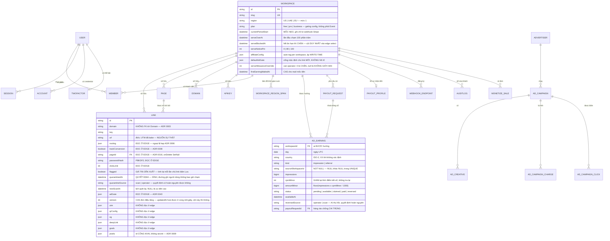
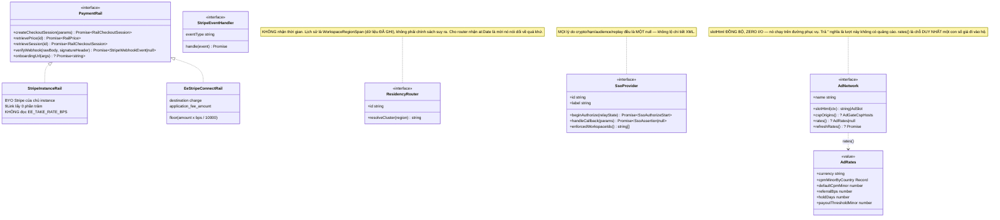

# Level 4 — Code

> **Neo số liệu — đọc trước khi tin bất kỳ con số nào ở dưới.** File này được viết ngược từ mã
> nguồn thật tại commit `b559c68` (`main`, 2026-09-08), cùng một neo với `README.md` của bộ C4.
> Mọi đường dẫn, số file, số dòng và số lượng nêu trong file **thuộc cây đó**, không phải cây mới
> nhất. Ví dụ đã đo bằng `git ls-tree`: `docs/adr/` có **47** file `.md` tại `b559c68` và **50** tại
> `4af8932` (2026-11-10) — cả hai đều đúng, tại cây của mình. Nên hãy đọc các con số ở đây như một
> **ảnh chụp có ngày**, và muốn biết hiện trạng thì đo lại trên cây đang đứng.


> **Câu hỏi sơ đồ này trả lời:** ở mức module, class và cột dữ liệu — **hợp đồng chính xác** mà các
> component ở Level 3 nói với nhau bằng gì.
>
> **Người đọc:** kỹ sư sắp sửa sửa đúng module đó.
>
> **Phạm vi có chủ ý:** C4 Level 4 đầy đủ cho ~108k dòng mã là một bản đồ không ai đọc. Tài liệu
> này chỉ phủ **những hợp đồng mà vi phạm chúng thì hỏng ở xa chỗ hỏng** — tức là chính định nghĩa
> "rủi ro kiến trúc" của repo này. Component tree React (`app/(app)/**`, `app/_home/**`) cố ý
> không phủ: nó đổi nhanh và hỏng thì hỏng ngay tại chỗ.

---

## 1. Xương sống dữ liệu — Postgres (mặt phẳng cấu hình)

34 model trong `packages/db/prisma/schema.prisma` (1.578 dòng), 55 migration, một datasource.
Nhóm theo trách nhiệm:



### 1.1 Năm quy ước dữ liệu áp dụng cho **mọi** model

| Quy ước | Nội dung | Vì sao |
|---|---|---|
| **Nhãn residency + PII trong schema** | Mỗi model mang `// @residency theo-vùng \| toàn-cục \| cần-quyết` và `// @pii <cột> \| —` | Một bảng phân loại đặt ở `docs/` sẽ lệch với schema kể từ model tiếp theo. Cổng `residency-schema-labels.test.ts` đọc **chính file schema** và ĐỎ khi thiếu nhãn. `—` nghĩa là *đã duyệt và kết luận không có*, **khác** với "chưa ai nhìn" |
| **`flagged` ≠ `quarantinedAt`** | Dẫn xuất vs quyết định, hai cột riêng | `flagged` được **tính lại** ở mỗi lần chủ link bấm Lưu ⇒ mọi kết luận mạnh hơn nằm chung ô đó sẽ bị đường ghi của chính chủ link **ghi đè im lặng**. Đây là bệnh *kiểu dữ liệu*, không phải bug lẻ |
| **Tiền là minor units, số nguyên** | `Int` cho một **mức giá**, `BigInt` cho một **tích luỹ** | Số thực nhị phân không biểu diễn được `0.1`. `floor` nghiêng về phía creator. ⚠️ Tầng JS đọc ra `Number` (chính xác tới 2^53) — BigInt mua **độ bền lược đồ**, không mua thêm dải số |
| **Khoá tự nhiên cho mọi thứ idempotent** | `ad_earnings(workspaceId, day, country, kind, sourceWorkspaceId)` · `ad_network_revenue(day, country, currency, source)` · affiliate import theo khoá mạng | Khoá tự nhiên là **toàn bộ** vế idempotent của một job chạy lại. Cột nullable trong UNIQUE là một cái bẫy: Postgres coi `NULL ≠ NULL` |
| **CHECK constraint chỉ sống trong migration SQL** | `ad_earnings_reversed_requires_source` · `ad_network_revenue` upper/lower case | Prisma **không mô hình hoá được CHECK**. Hệ quả phải nói ra: `prisma migrate` **mù** với chúng, nên "drift rỗng" không phải bằng chứng chúng còn đó — cổng `e2e:m34:margin [G10]` hỏi thẳng `pg_constraint` |

### 1.2 Hai sổ audit, không phải một

| Sổ | Khoá | Ai đọc | Vì sao tách |
|---|---|---|---|
| `audit_logs` | `workspaceId` **NOT NULL** | Khách, tại `/govern` | Nó là sổ **của một khách**. Đó không phải trở ngại kỹ thuật cần lách — đó là định nghĩa |
| `ops_audit_logs` | không workspace | Operator | Một lượt nhập doanh thu mạng là con số **của cả nền tảng**. Gán bừa vào một workspace sentinel là **bịa ra một chủ sở hữu** mà mọi truy vấn gộp-theo-workspace về sau sẽ đọc như thật |

## 2. Mặt phẳng sự kiện — ClickHouse

**Một bảng duy nhất.** Đây là bất biến §0.2 của `CLAUDE.md` và là thứ được gọi là *moat* — không
phải feature. DDL nguồn sự thật nằm trong mã (`apps/web/lib/clickhouse.ts`), không nằm trong một
file `.sql` rời:

```sql
CREATE TABLE IF NOT EXISTS events
(
  event_id     UUID,
  event_type   LowCardinality(String),   -- click | scan | view | convert | earn | impression
  ts           DateTime64(3),
  link_id      String,
  workspace_id String,
  domain       String,
  key          String,
  country      LowCardinality(String) DEFAULT 'XX',
  device       LowCardinality(String) DEFAULT 'unknown',
  os           LowCardinality(String) DEFAULT 'unknown',
  browser      LowCardinality(String) DEFAULT 'unknown',
  referrer     String DEFAULT '',
  ua_hash      String DEFAULT '',        -- FNV-1a. KHÔNG lưu UA thô, KHÔNG lưu PII
  variant      String DEFAULT '',        -- A/B variant key, rỗng khi không A/B
  click_id     String DEFAULT '',        -- opaque cid, join query-time — ADR 0008
  event_name   String DEFAULT '',        -- tên goal của convert; KẾT CỤC của impression
  value        Float64 DEFAULT 0,        -- doanh thu convert; minor units cho earn; 0 cho impression
  currency     LowCardinality(String) DEFAULT '',
  is_bot       UInt8 DEFAULT 0,          -- phân loại LÚC INGEST, vì sau đó chỉ còn ua_hash
  chain_key    String DEFAULT ''         -- MỘT chuỗi chạm, xoay theo TUẦN — ADR 0046
)
ENGINE = MergeTree
PARTITION BY toYYYYMM(ts)
ORDER BY (workspace_id, link_id, ts)
```

### 2.1 Bốn luật của bảng `events`

| Luật | Nội dung | Hệ quả nếu vi phạm |
|---|---|---|
| **Additive-only** | Cột mới qua `ALTER TABLE … ADD COLUMN IF NOT EXISTS` (`EVENTS_ALTERS`), `event_type` mới **không cần DDL** nhờ `LowCardinality` | Payload cũ còn trong hàng đợi Redis không vỡ; row cũ nhận DEFAULT |
| **Thứ tự cột là hợp đồng** | `chain_key` phải đứng **CUỐI** ở cả DDL lẫn `EVENTS_ALTERS` | Bảng đang chạy nhận nó qua `ADD COLUMN` nên nằm cuối; bảng dựng mới nhận theo thứ tự viết. Hai đường lệch nhau ⇒ ba cổng so **chuỗi có thứ tự** đỏ trên mọi DB mới tinh — và lượt đỏ *sau đó* mới đáng sợ: người dọn một cổng đỏ-giả sẽ nới đúng cái cổng chống-cột-lạ |
| **Không PII thô** | Chỉ `country/device/os/browser/referrer` + `ua_hash` | Bất biến §5. `chain_key` là HMAC có salt của `9lv`, **xoay theo tuần** — không suy ngược được |
| **Không tiền trong Event** | `impression.value = 0`; `earn.value` chỉ là bản ghi *đã có tiền*, không phải nguồn tính tiền | Ghi tiền vào kho append-only là **tự khoá mình khỏi việc sửa sổ**. Event đếm sự kiện, ledger tính tiền |

### 2.2 `''` không phải một nhóm

Hai cột dùng chuỗi rỗng làm giá trị "không áp dụng" — `variant` và `chain_key`. Mọi truy vấn
chuỗi **phải lọc `chain_key != ''`**, nếu không toàn bộ lịch sử trước mốc M29 dồn thành **một
chuỗi gồm mọi người từng tồn tại**. Row cũ **không bao giờ** được hồi tố.

## 3. Hợp đồng hot path — `ResolvedLink`

Đây là hợp đồng quan trọng nhất ở Level 4: nó là **ranh giới giữa "zero-cost" và "thêm một lượt
I/O"**. Định nghĩa tại `apps/web/lib/link-cache.ts`, được nạp bằng một `select` **tường minh** từ
Prisma và được cache trong Redis 60 giây.

| Trường | Kiểu | Trụ | ADR cho phép kéo vào hot path | Khi "tắt" |
|---|---|---|---|---|
| `id`, `url`, `domain`, `key`, `workspaceId` | string | 1 | M0 — lõi | — |
| `expiresAt`, `archived` | Date?, bool | 8 | M0/M5 | `null` / `false` |
| `routing` | `Routing \| null` | 3 | **ADR 0006** — ngoại lệ hẹp **đầu tiên** với ADR 0003 | `null` ⇒ 302 thẳng, không `buildContext` |
| `trackConversion` | boolean | 5 | **ADR 0008** | `false` ⇒ không sinh `cid`, 302 y hệt M3 |
| `passwordHash` | string? | 8 | M5/T5.4 | `null` ⇒ bỏ qua hoàn toàn |
| `clickLimit` | int? | 8 | M5/T5.5 | `null` ⇒ zero I/O mới |
| `flagged` | boolean | 8 | **ADR 0012** | `false` |
| `quarantined` | boolean | 8 | M18/T18.3 | `false` — đọc qua `?? false` vì payload cache cũ không có khoá này |
| `pageId` | string? | 4 | **ADR 0016** | `null` ⇒ 302 byte-identical M6 |
| `serveBlocked` | boolean | 8/billing | M22/T22.2 · **ADR 0041** | `false` — boolean **đầu tiên** mô tả trạng thái *workspace*, không của link |
| `version` | int | — | M22/T22.4 | Edge **không đọc** để quyết định gì; nó có mặt vì **lệnh ghi cache** cần một con số so được |
| `adGate` | `AdGate \| null` | 7 | M24/T24.1 · **ADR 0043** — ngoại lệ hẹp **thứ năm**, và là ngoại lệ kéo cả **config** chứ không một boolean | `null` ⇒ short-circuit qua một phép so falsy, 302 byte-identical M23 |

**Ba điều rút ra:**

1. **Blob không bao giờ vào hot path.** `utm`, `qrConfig`, `og`, `deepLink`, `goals`, `pixels`,
   `campaign`, và toàn bộ `blocks`/`theme` của bio page nằm ở payload cache **riêng** (`page-cache`)
   hoặc chỉ đọc ở dashboard.
2. **Mọi ngoại lệ đều có ADR.** Nếu bạn sắp thêm trường thứ 13 vào bảng trên, bạn đang viết ADR
   thứ sáu của họ này — không phải "sửa một type".
3. **`toPayload()` là writer duy nhất vào cache.** Giá trị được validate ở đó và **cast** khi đọc
   ra. Ai thêm một writer thứ hai phải đi qua `toPayload`, không tự dựng object.

### 3.1 `ClickEvent` — payload vào hàng đợi

`apps/web/lib/events.ts`. Chú ý ba trường **optional**: đó là cơ chế cho phép deploy mà không vỡ
payload đang bay trong hàng đợi Redis do mã cũ dựng.

```ts
export type ClickEvent = {
  event_id: string;
  event_type: string;          // click | scan | view | convert | earn | impression
  ts: string;                  // ISO — worker chuyển sang DateTime64
  link_id: string;
  workspace_id: string;
  domain: string;
  key: string;
  country: string; device: string; os: string; browser: string;
  referrer: string; ua_hash: string;
  variant: string;             // '' khi không A/B
  click_id: string;            // '' khi không track
  event_name: string;          // goal của convert; KẾT CỤC của impression
  value: number;               // 0 cho click/scan/impression
  currency?: string;           // OPTIONAL — M8: builder cũ không set ⇒ JSON.stringify bỏ qua
  chain_key?: string;          // OPTIONAL — M29. KHÔNG MINT cookie mới ở đường click
  is_bot?: 0 | 1;              // OPTIONAL — M11. Phân loại ĐỒNG BỘ trong handler, chỉ enqueue nằm trong after()
};
```

⚠️ `buildClickEvent` chạy **ĐỒNG BỘ** trong handler; chỉ `enqueueEvent` nằm trong `after()`. Bất
biến zero-cost vẫn giữ vì phân loại bot là ~15 phép so chuỗi ngắn **thuần CPU, không I/O**. Đừng
chép lại câu "chạy trong nhánh after() async" — sai, và đã có reviewer đính chính.

⚠️ Marker `bot` **trần** đã bị gỡ khỏi `BOT_UA_MARKERS`: substring `bot` khớp **CUBOT** — một hãng
điện thoại Android có thật, phổ biến ở đúng thị trường mới nổi/MENA của wedge. Hệ quả không chỉ là
mất vài click: `CLICK_DEDUP` lọc `is_bot = 0`, mà overview tính convert + doanh thu bằng INNER JOIN
nhánh click ⇒ **đơn hàng của khách thật biến mất im lặng khỏi báo cáo**.

## 4. Năm ổ cắm — chữ ký TypeScript

Đây là Level 4 của ranh giới open-core. Mỗi interface là một **hợp đồng pháp lý** autant que kỹ
thuật: nó quyết định cái gì được phép là mã thương mại.



### 4.1 Vì sao trạng thái ổ cắm nằm trên `globalThis[Symbol.for(...)]`

Khuôn ADR 0029, áp dụng **giống nhau** cho cả năm registry:

```ts
const SLOT_KEY = Symbol.for("ninelink.govern.residency-registry");
function slot(): Slot {
  const g = globalThis as unknown as Record<symbol, Slot | undefined>;
  const existing = g[SLOT_KEY];
  if (existing !== undefined) return existing;
  const fresh: Slot = { router: null };
  g[SLOT_KEY] = fresh;
  return fresh;
}
```

Hai vấn đề thật, đã đo:
1. **webpack nhân đôi module** giữa entry `instrumentation` và đồ thị route ⇒ hai biến module-scope
   khác nhau ⇒ ổ cắm được đăng ký ở bản này, đọc ở bản kia, **không lỗi nào hiện ra**.
2. **minifier gấp** một biến module-scope luôn-`null` rồi **xoá** nhánh đọc registry.

`Symbol.for` + `globalThis` chữa cả hai.

### 4.2 Luật kế thừa: ổ có chủ thì chủ giữ ổ, kể cả khi trả `null`

```ts
export function resolveAdNetwork(): AdNetwork | null {
  if (adNetworkSlotTaken()) return registeredAdNetwork();   // ← kể cả null
  const html = process.env.AD_NETWORK_TAG ?? "";
  return html && html.trim() !== "" ? new EnvAdNetwork(html) : null;
}
```

Bản ngây thơ sẽ viết `registeredAdNetwork() ?? envNetwork()`. Trên Cloud, `/ee` trả `null` nghĩa là
*"publisher này **chưa được duyệt** vào mạng"* — rơi xuống `EnvAdNetwork` nghĩa là phục vụ bằng mã
quảng cáo trong env của **chính instance**, doanh thu về túi ta, **không một dòng ledger nào**, và
mọi cổng vẫn xanh. Luật này đến từ một `[CHẶN]` của security-review T15.4.

## 5. Bảng tên: cookie · tham số · header · tiền tố

Mọi thứ trong bảng này là **hợp đồng với trình duyệt hoặc với khách**. Đổi một cái là phá client.

| Loại | Tên | Đặt bởi | Đọc bởi | Ghi chú |
|---|---|---|---|---|
| Cookie | `9lv` | `/{key}` **chỉ khi thật sự bucket A/B** | `/{key}`, `/measure` (chain_key) | Random id, không PII. 🔒 **Cố ý không mint** cho mọi click — ADR 0046 dựa trên đúng một lời hứa: *không thu thập gì mới* |
| Cookie | `9lp_<linkId>` | POST form mật khẩu | GET kế tiếp | `<exp>.<sigB64url>`, HMAC-SHA256 phủ `9lp:<linkId>:<exp>`. HttpOnly · SameSite=Lax · Secure-prod · Max-Age ngắn. **Prod thiếu secret ⇒ THROW** (fail-closed) |
| Cookie | `9lg_<linkId>` | POST qua cổng quảng cáo | GET kế tiếp | Vé đã-qua-cổng, 60 giây. Cùng nước đi với `9lp_` để **đuôi 302 không đổi một dòng** |
| Cookie | `9l_ws` | `switchWorkspaceAction` **sau khi** kiểm membership | mọi request dashboard | httpOnly. Có guard **hình dạng** giá trị trước khi tra DB |
| Cookie | `NEXT_LOCALE` | locale switcher | `lib/i18n/request.ts` | next-intl *without i18n routing* — **không middleware**, để redirect bất biến (ADR 0014) |
| Query | `9l_cid` | append vào `Location` khi `trackConversion` | trang đích → `POST /api/track/convert` | Strip cid cũ + canonical, **không nối query request** ⇒ `?qr=1` vẫn không rò |
| Query | `qr=1` | QR code | `buildClickEvent` | Marker phân biệt `scan` với `click` (ADR 0005). **Không forward xuống đích** |
| Query | `ref` | `/signup` (từ `/r/<code>`) | onboarding referral | `/r/<code>` **không đặt cookie** — cookie do trang `/signup` đặt, một người ghi duy nhất |
| Form field | `gate_token`, `gate_answer` | trang cổng | POST `/{key}` | Chuỗi ký `9la:1:<linkId>:<stage>:<iat>:<nonce>` — bốn thứ, mỗi thứ đóng một cách bịa ra tiền |
| Header | `Authorization: Bearer nlk_…` | client | `lib/api/keys/authenticate.ts` | SHA-256 **không salt** (ADR 0002); token thô hiện đúng một lần |
| Header | `9link-signature` | worker delivery | consumer | HMAC-SHA256, secret `whsec9_…`, scheme kiểu Stripe |
| Header | `Accept-Language` | trình duyệt | trang 402 · form mật khẩu · interstitial · trang cổng | Ba trang vô danh render **3 ngôn ngữ + RTL** từ header, không từ cookie |
| Tiền tố | `nlk_` · `whsec9_` · `evt_` | — | — | API key · webhook secret · webhook delivery id |

## 6. Luật phụ thuộc module

Không có sơ đồ nào vẽ hết ~400 module. Thay vào đó là **bảy luật**, mỗi luật có cổng máy:

| # | Luật | Cổng gác |
|---|---|---|
| 1 | **Core không bao giờ nhắc tên `ee/`** — ở bất kỳ dạng import nào, kể cả `import()` động trong nhánh không bao giờ chạy | `scripts/gate-ee-dir.mjs` — **đo bundle**, không tin cấu hình |
| 2 | **Import không đuôi file** (`./x`, không phải `./x.js`) trong mọi gói Next/workspace TS | `eslint.config.mjs` |
| 3 | **Một trang công khai vô danh không được kéo Prisma vào đồ thị import** — kể cả **bắc cầu** | `app/landing-public.test.ts` (duyệt import bắc cầu; bài học: *một chú thích cấm không phải một cổng*) |
| 4 | **`lib/publish/render.ts` là thuần** — không tự đọc env; cờ rail và ô quảng cáo được **truyền vào** | test T8.3/T38.0: page không monetize ⇒ HTML byte-identical |
| 5 | **`lib/validation.ts` là module NỀN** — không được hỏi registry mạng quảng cáo | ADR 0044 §2: sàn cấu hình đặt ở `updateLink()`, không ở biên Zod |
| 6 | **Ba module cố ý là LÁ, 0 import** — `lib/cluster-id.ts`, `lib/govern/residency.ts`, `lib/postgres-clusters-declared.ts` | Chúng phải trả lời được câu hỏi cho một trang công khai mà không kéo theo bất kỳ thứ gì |
| 7 | ** Dependency manifest bị đóng băng** | `.gate/frozen.sha256` (schema + migration + file nhạy cảm) · `.gate/deps.json` · `scripts/gate-deps.mjs` · `scripts/gate-frozen-floor.mjs` |

### 6.1 Ba mẫu thiết kế lặp lại đủ nhiều để thành quy ước

| Mẫu | Xuất hiện ở | Nội dung |
|---|---|---|
| **Registry + seal** | 5 ổ cắm `/ee` | `register*()` ném sau khi `seal*()`; seal trong `finally` ở **mọi** nhánh |
| **Fail-closed cho tiền, fail-soft cho tiện ích** | `getPaymentRail()` vs `getLlm()` | Hai pattern "cổng theo env" **đừng nhầm**: thiếu key tiền ⇒ THROW; thiếu key LLM ⇒ `null` + một dòng ghi chú trong UI |
| **Snapshot RAM đồng bộ + refresh có nhịp** | `ee/ads/snapshot.ts`, `ee/monetize/rate-snapshot.ts` | Đường phục vụ **không await**. `refreshRates()` là hợp đồng để worker **ép làm mới trước khi kết sổ** — vì con số đó là tiền ghi vào sổ publisher, không phải câu trả lời "có bảng giá hay không" |

## 7. Những con số cần biết trước khi sửa mã

| | |
|---|---|
| TypeScript | `strict: true` · `noUncheckedIndexedAccess: true` · target ES2022 · `moduleResolution: Bundler` |
| Quy mô | ~108,7k dòng phi-test · ~50,7k dòng test · 240 file unit test · 78 file e2e |
| Test runner | `vitest` (web · sdk · ee mỗi gói một config) |
| Cổng verify | `scripts/verify.sh` — 5 bước + **46 cổng `GATE-*`**, có watchdog, tự in `===VERIFY_EXIT` / `===SKIP` / `===SERVER` |
| Lint | `eslint . --max-warnings=0` |
| Định nghĩa "xong" | `CLAUDE.md §6` — 6 vế, trong đó có **`next build` XANH** (bài học #5: build chết ở prerender mà test/lint/typecheck vẫn xanh) |

⚠️ **`===VERIFY_EXIT` mới là mã của cổng.** Lượt nền báo "exit code 0" trong khi `VERIFY_EXIT=1`
— đúng khuôn *"exit code của một pipe là của lệnh cuối"*. Đọc **ba dòng `===`**, đừng đọc vỏ shell.

⚠️ **Cổng dựng xong mà không nối vào `verify.sh` thì không tồn tại.** Bốn cổng M45 đã được dựng
và chỉ chạy khi có người nhớ gõ tay, trong khi HANDOFF vẫn khai `SKIP=0` — vì `SKIP` đếm những
cổng **đã ở trong suite**, không đếm những cổng **lẽ ra phải ở đó**. Câu hỏi bắt buộc khi đóng
mốc: *"cổng tôi vừa dựng có nằm trong `verify.sh` không?"*
