# Dynamic views — 12 luồng chạy qua các hộp

> **Neo số liệu — đọc trước khi tin bất kỳ con số nào ở dưới.** File này được viết ngược từ mã
> nguồn thật tại commit `b559c68` (`main`, 2026-09-08), cùng một neo với `README.md` của bộ C4.
> Mọi đường dẫn, số file, số dòng và số lượng nêu trong file **thuộc cây đó**, không phải cây mới
> nhất. Ví dụ đã đo bằng `git ls-tree`: `docs/adr/` có **47** file `.md` tại `b559c68` và **50** tại
> `4af8932` (2026-11-10) — cả hai đều đúng, tại cây của mình. Nên hãy đọc các con số ở đây như một
> **ảnh chụp có ngày**, và muốn biết hiện trạng thì đo lại trên cây đang đứng.


> **Câu hỏi tài liệu này trả lời:** các container và component ở Level 2–3 **phối hợp theo thứ tự
> nào** trong những luồng quan trọng. Đây là *supplementary view* của C4 — không phải một mức
> phóng đại thứ năm, mà là cùng những hộp đó, vẽ theo thời gian.
>
> **Vì sao tài liệu này đứng trước Level 3 trong thứ tự đọc khuyến nghị:** ở một hệ thống mà tài
> sản cốt lõi là *đường đi của một cú click*, đọc luồng trước rồi mới đọc cấu trúc khiến cấu trúc
> có nghĩa ngay.
>
> **Quy ước:** mỗi luồng ghi kèm **bất biến nó bảo vệ** và **cổng máy nào đo nó**. Một luồng không
> có cổng đo là một luồng đang được tin chứ không phải được biết.

| # | Luồng | Bất biến được bảo vệ | Cổng đo |
|---|---|---|---|
| D1 | Click thường → 302 | zero-cost | `e2e:m0-loop` · `m1-create` |
| D2 | Click có routing + A/B + tracking | rule đánh giá không I/O | `e2e:m3-route` |
| D3 | Link có mật khẩu | đích chỉ lộ sau mật khẩu | `e2e:m5-govern` |
| D4 | Qua cổng quảng cáo → impression → tiền | hai hệ quả tách rời | `GATE-ADGATE` (73 phép đo) |
| D5 | Link gắn bio page | page thắng routing, CSP không đổi | `e2e:m7-publish` · `GATE-PAGE-AD` |
| D6 | Ingest Event | một lớp dữ liệu, fail-closed residency | `GATE-M19-WRITE` · `GATE-RESIDENCY` |
| D7 | Attribution convert | không bịa ra tiền | `GATE-ORACLE` · `GATE-REPLAY-ORACLE` · `GATE-IDEM` |
| D8 | Kết sổ → ví → rút tiền | không nhân đôi, không chi trùng | `GATE-WALLET` · `GATE-PAYOUT` · `GATE-STEPUP` |
| D9 | Webhook Stripe billing | single-writer của tiền | `GATE-MONEY` · `GATE-PERIOD` |
| D10 | Webhook OUT delivery | at-least-once, không phải Event | `e2e:m9-connect` · `m13-connect-rest` |
| D11 | Chống lạm dụng | quyết định ≠ giá trị dẫn xuất | `GATE-ABUSE` · `GATE-FEEDS` |
| D12 | Boot & seal ổ cắm | không ai chiếm ổ sau boot | `GATE-EE-DIR` · `GATE-PLATFORM-DEFAULT` |

---

## D1 — Click thường: đường cơ sở mà mọi mốc phải giữ nguyên byte

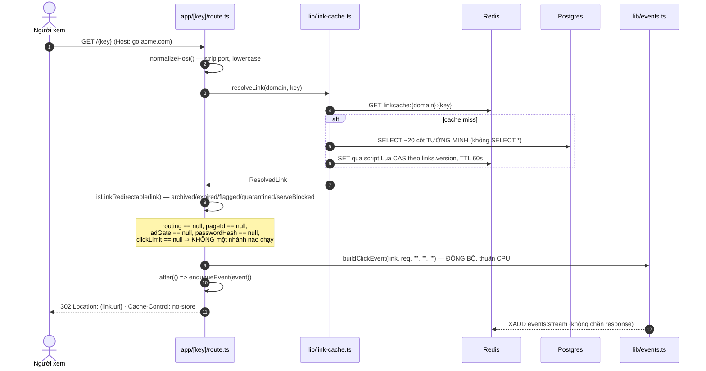

**Điểm cần nhớ:** `parseUA` chạy **đúng một lần** (trong `buildClickEvent`), và nó chạy **sau**
khi đã quyết định `Location`. Toàn bộ chi phí thêm của trụ Measure/Optimize/Govern trên một link
tắt hết mọi tính năng là **0 lượt I/O**.

## D2 — Click có routing + A/B + conversion tracking

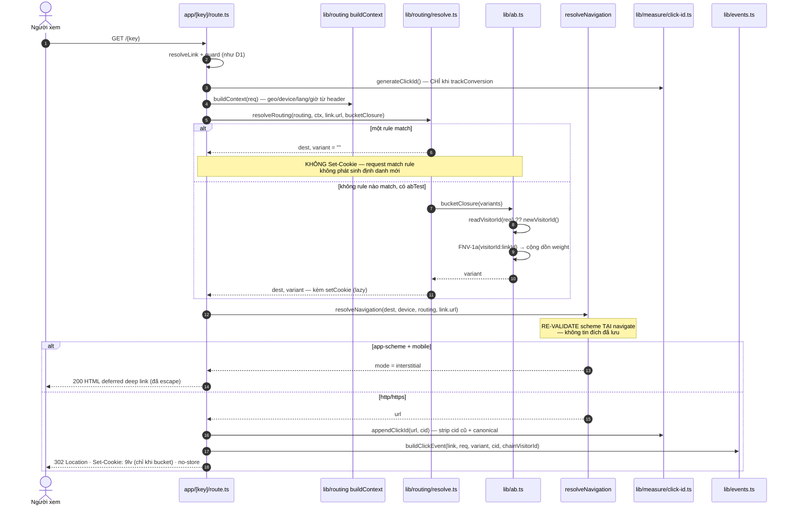

**Hai ràng buộc không hiển nhiên:**

1. **Cookie `9lv` chỉ sinh khi thật sự bucket.** Lazy qua closure side-effect. Nếu sinh cho mọi
   click thì ADR 0046 ("không thu thập gì mới") thành lời hứa sai.
2. **Không append `cid` vào app-scheme** — deep link không mang param web; click event vẫn có cid.
   Và **không forward query của request xuống đích** ⇒ marker `?qr=1` không rò.

## D3 — Link có mật khẩu

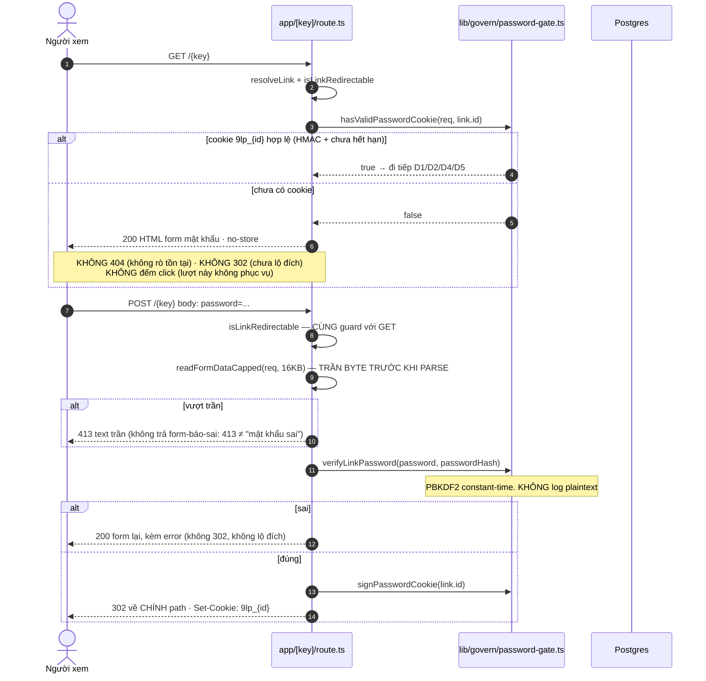

**Vì sao POST phải lặp lại guard:** xem §1.1 của Level 3 — M24 làm POST **sinh ra tiền**, và một
nhánh POST không guard là cửa sau đi vòng qua toàn bộ trụ Govern.

## D4 — Qua cổng quảng cáo: hai chặng, một loại tiền tự đo được

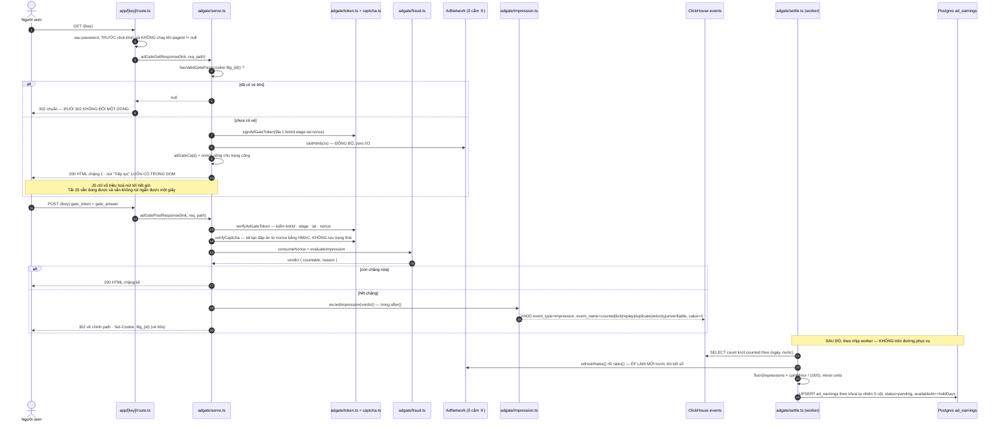

**Nguyên tắc đứng trên tất cả — hai hệ quả tách rời (ADR 0043 §4):**

| | |
|---|---|
| ① người xem có được phục vụ không | **LUÔN LUÔN CÓ**, không ngoại lệ. Không lối ra nào của `serve.ts` là 4xx/5xx |
| ② chủ link có được tính tiền không | chỉ khi **mọi** vế kiểm được **và** sạch |

Gộp lại là cách mọi nền tảng paid-to-click tự bắn vào chân mình: một dương-tính-giả biến thành
"link chết" với người thật — mà người thật **không khiếu nại**, họ chỉ không quay lại.

Hệ quả thứ hai: **"không kiểm được" ≠ "sạch"**. Redis chết, thiếu khoá HMAC, cấu hình lệch ⇒
`unverifiable` ⇒ không tính tiền, còn visitor vẫn đi tiếp.

## D5 — Link gắn bio page: cùng một URL, hai hành vi

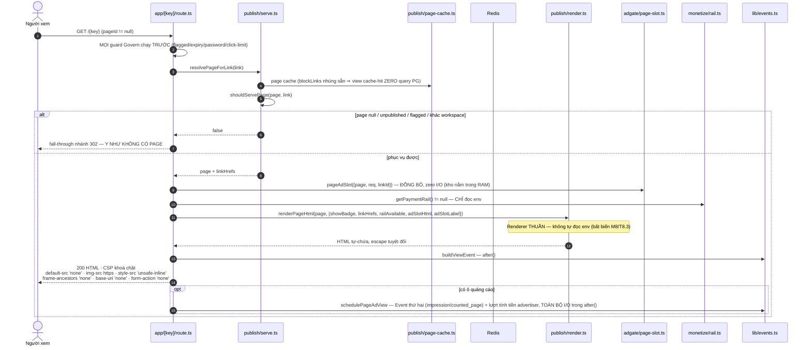

CSP nguyên văn của trang bio (ghi lại ở đây vì sơ đồ không chứa được dấu `;`):

```
Content-Security-Policy:
  default-src 'none'; img-src https:; style-src 'unsafe-inline';
  frame-ancestors 'none'; base-uri 'none'; form-action 'none'
```

`frame-ancestors`/`base-uri`/`form-action` **không fallback** về `default-src` — khai tường minh để
chống clickjacking/overlay-phishing lên một trang bio công khai (điều kiện security-review T7.3).
Kèm `X-Content-Type-Options: nosniff` và `Cache-Control: no-store`.

**Ba điều kiện khiến nhánh này an toàn để bật trên đường nóng:**

1. `pageId == null` ⇒ short-circuit qua một phép so falsy ⇒ 302 **byte-identical** mốc trước.
2. Renderer **thuần** ⇒ CSP của bio page không đổi một byte khi bật monetize hoặc ô quảng cáo
   (có test gác).
3. Lỗi PG/chậm giữa lúc render ⇒ **fail-soft** về nhánh 302, không 500 trang public.

## D6 — Ingest Event: từ `after()` tới đúng cụm ClickHouse

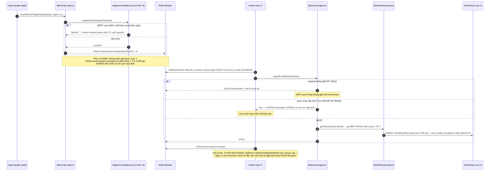

**Đường đọc đối xứng:** `lib/analytics-fanout.ts` fan-out theo `WorkspaceRegionSpan` (bản đồ
**thời gian → cụm**) rồi gộp, và trả kèm `residencyCaveats` — dashboard **nói ra** khi một con số
không phủ trọn lịch sử, thay vì im lặng cộng hai cụm.

## D7 — Attribution: từ cú click tới một chuyển đổi không bịa được

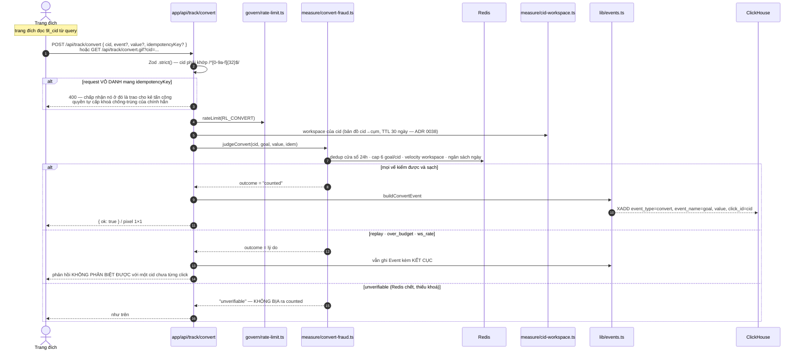

**Bất biến được đo bằng `GATE-ORACLE`:** bão hoà trần qua link A ⇒ phản hồi cho link B **cùng
workspace** phải không phân biệt được với một cid chưa từng click. Nếu phân biệt được, trần chống
gian lận trở thành một **oracle** cho kẻ tấn công dò ranh giới tenant.

**Multi-touch (ADR 0046):** `chain_key = SHA-256(9lv | tuần-ISO | salt)` cắt 128 bit — nối các
điểm chạm thành chuỗi mà **không thu thập gì mới**. Độ phủ là một **con số phải đo** (`/measure`),
không phải một giả định: chuỗi chỉ hình thành cho visitor đã có `9lv`, tức đã từng chạm một link
có A/B.

## D8 — Tiền: từ sổ cái tới ví tới một lượt rút

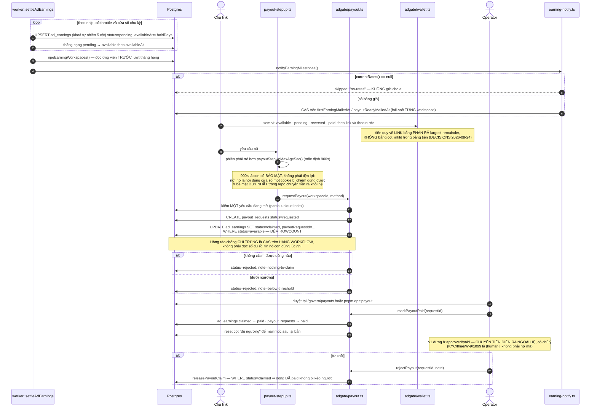

**Quarantine cắt vào đâu:** `quarantineLink` thu hồi thu nhập **đúng một lần** tại thời điểm chặn,
theo **hai mức tuỳ ai ra phán quyết**:

| Ai | Thu hồi | Vì sao |
|---|---|---|
| **operator** | tất cả, kể cả phần đã mở khoá | Nếu không, kẻ farm chỉ cần chờ hết hạn giữ |
| **quét tự động** | chỉ đóng băng `pending` | Dương-tính-giả không được cướp tiền người vô tội |

Và `reversed` **thôi là trạng thái chết, nhưng chỉ theo một chiều**: phán quyết của **máy**
(`reversedSource='scan'`) đảo ngược được khi quarantine được gỡ; của **người** thì không. `report`
(báo cáo vô danh) xếp vào MÁY — một biểu mẫu công khai không được có quyền xoá vĩnh viễn thu nhập
của người khác.

## D9 — Stripe billing webhook: single-writer của tiền

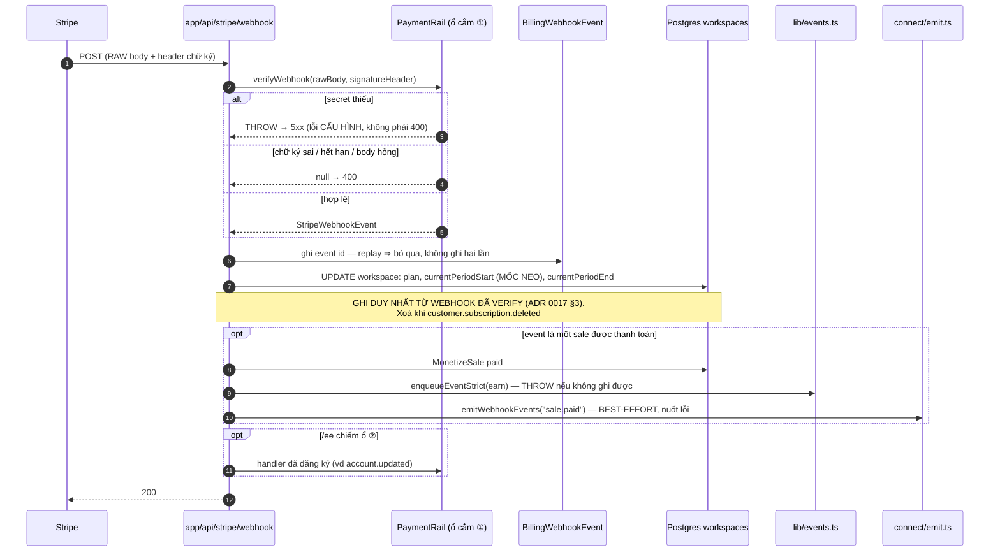

**Vì sao `currentPeriodStart` là mốc neo chứ không phải "đầu cửa sổ đang đo":** cửa sổ đo lặp
**hằng tháng** từ mốc neo, vì `PLAN_MONTHLY_SERVE_ALLOWANCE` là trần **tháng** — còn gói **năm**
có `currentPeriodEnd` cách 12 tháng. Lấy thẳng chu kỳ Stripe làm cửa sổ = cho khách gói năm
**12× trần** trong một kỳ (ADR 0042).

`currentPeriodEnd` **không tham gia tính cửa sổ**, cố ý: webhook trễ/mất một kỳ thì cửa sổ vẫn
phải tự trôi, không được đứng im khoá khách trong kỳ cũ.

## D10 — Webhook OUT: tín hiệu, không phải Event

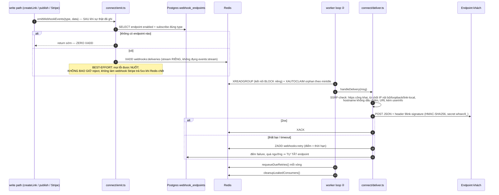

**Payload không bao giờ chứa PII** — chỉ `id` + field nghiệp vụ. Và `link.deleted` **không kèm
`url`**: gửi kèm đích của một link vừa bị xoá là phát tán thêm một bản dữ liệu của khách mà không
ai cần.

**Loại mới không tự chảy vào endpoint cũ.** Endpoint chỉ nhận đúng những type nó đã đăng ký. 9Link
cố ý **không** tự thêm hộ — vì đó vừa là đổi hợp đồng sau lưng consumer, vừa là một cú bùng nổ lưu
lượng (`bulk` 100 link × N endpoint).

## D11 — Chống lạm dụng: bốn lớp, và chỗ mỗi lớp đứng

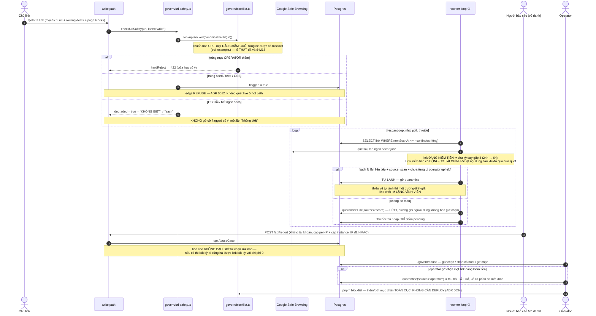

## D12 — Boot: thứ tự là một phần của phép đo

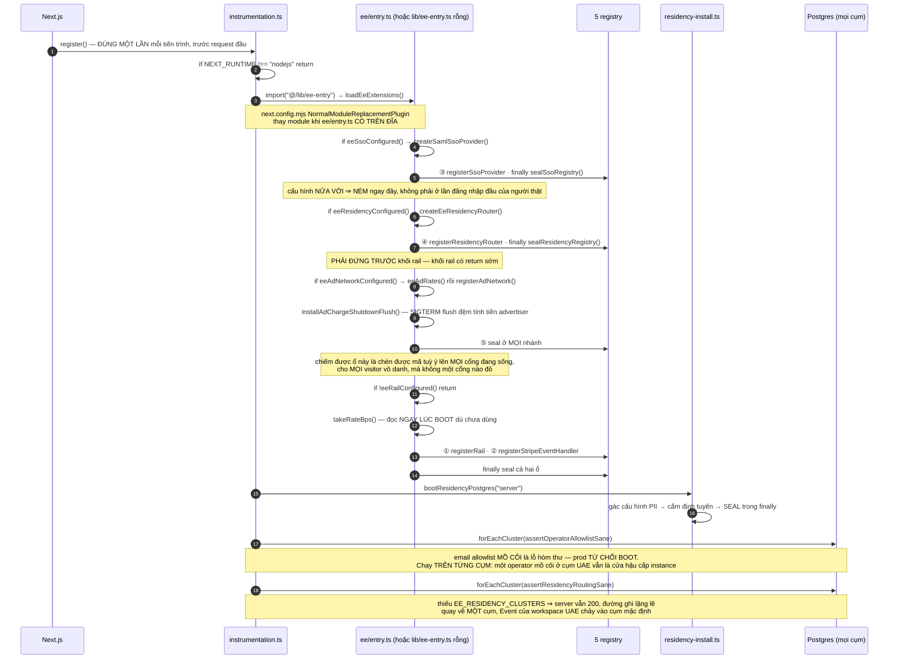

**Vì sao thứ tự ở khối này là một phần của phép đo (M30/T30.6):** bản đầu đặt việc cắm ổ PII
**sau** hai phép gác đọc DB. Lúc hai phép gác đó chạy, resolver còn `null` ⇒ `prisma` trỏ cụm mặc
định ⇒ chúng chỉ còn đo **1/N vùng**. Hai kiểm soát an ninh có từ M18/M19 bị **hạ cấp im lặng** —
không cổng nào đỏ, không log nào đổi.

**Worker cũng nạp ổ cắm** (`loadSeams()` trong `worker/index.ts`): không có nó thì job kết sổ
không biết giá, và nó sẽ im lặng kết sổ với `rates() == null` — tức không một dòng sổ nào.
