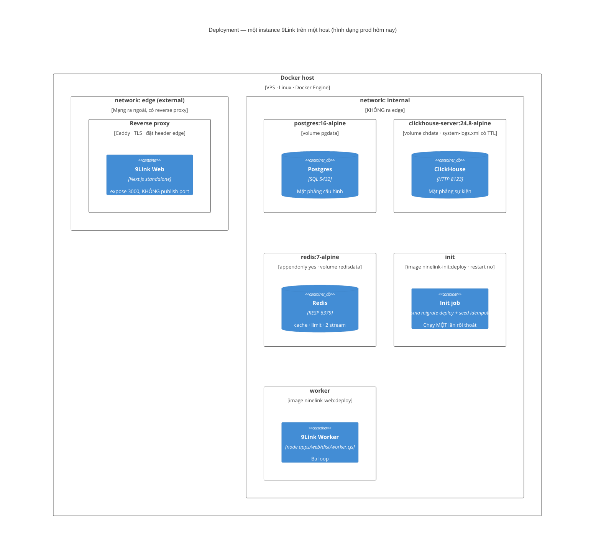

# Deployment view — container nào chạy ở đâu

> **Neo số liệu — đọc trước khi tin bất kỳ con số nào ở dưới.** File này được viết ngược từ mã
> nguồn thật tại commit `b559c68` (`main`, 2026-09-08), cùng một neo với `README.md` của bộ C4.
> Mọi đường dẫn, số file, số dòng và số lượng nêu trong file **thuộc cây đó**, không phải cây mới
> nhất. Ví dụ đã đo bằng `git ls-tree`: `docs/adr/` có **47** file `.md` tại `b559c68` và **50** tại
> `4af8932` (2026-11-10) — cả hai đều đúng, tại cây của mình. Nên hãy đọc các con số ở đây như một
> **ảnh chụp có ngày**, và muốn biết hiện trạng thì đo lại trên cây đang đứng.


> **Câu hỏi tài liệu này trả lời:** các container ở Level 2 được đóng gói, đặt vào mạng nào, gắn
> volume nào, khám sức khoẻ ra sao, và nhân bản theo vùng thế nào.
>
> **Người đọc:** người vận hành · người self-host · người đánh giá chủ quyền dữ liệu.
>
> Đây là *supplementary view* của C4, không phải một mức phóng đại. Nó dùng ký pháp deployment của
> Mermaid cho hình dạng tổng, và bảng cho chi tiết — vì phần lớn sự thật triển khai của repo này
> nằm trong **cấu hình có lý do**, không nằm trong topo.

---

## 1. Hình dạng triển khai tham chiếu (`deploy/docker-compose.yml`)



### 1.1 Bốn quyết định triển khai, mỗi cái một lý do đo được

| Quyết định | Nội dung | Lý do |
|---|---|---|
| **Web chỉ `expose: 3000`, không `ports:`** | Ra ngoài duy nhất qua reverse proxy trên mạng `edge` | Postgres/ClickHouse/Redis nằm trên mạng `internal` và **không có đường nào** từ edge tới chúng |
| **`web` và `worker` dùng CHUNG một image** | `ninelink-web:deploy`, khác nhau ở `command` | Build một lần. `worker` chạy `node apps/web/dist/worker.cjs` (bundle esbuild), không phải `tsx` |
| **`init` là một job, không phải một lệnh trong entrypoint** | `restart: "no"`, `depends_on: service_completed_successfully` | Migration **không** chạy song song với N replica của web. Seed **idempotent** nên redeploy không nhân đôi dữ liệu demo |
| **Healthcheck của `web` là `/api/health`, KHÔNG phải `/api/health/ready`** | Đã đổi từ `/login` ở M21/T21.0 | `/login` là một trang React SSR: nó đo "render nổi một trang không", tức ĐỎ khi phụ thuộc chập ⇒ dùng làm **liveness** là mời orchestrator **giết container còn khoẻ**. `/api/health` là zero-I/O. Muốn đo "phục vụ được chưa" thì đó là `/api/health/ready` — và nó **cố ý không** nằm trong healthcheck |

### 1.2 Hai endpoint sức khoẻ là hai câu hỏi khác nhau (ADR 0040)

| Endpoint | Câu hỏi | Hỏi phụ thuộc? | Vô danh thấy gì |
|---|---|---|---|
| `GET /api/health` | *Tiến trình này còn sống không?* | **Không** — zero I/O, có bao đóng import được unit gác | `status`, `service`, `buildSha`, `uptimeSec`, `startedAt` |
| `GET /api/health/ready` | *Tiến trình này phục vụ được chưa?* | **Có** — Postgres, Redis, ClickHouse, **và nhịp tim job** (ADR 0042) | `503` khi có phụ thuộc hỏng, nhưng **không nói dịch vụ nào** |
| Cả hai + `HEALTH_DETAIL_TOKEN` | *Cái gì hỏng?* | — | Chi tiết chỉ lộ khi có token |

⚠️ **Nhịp tim job là một phần của readiness.** Một worker chết không làm `/api/health/ready` đỏ
nếu readiness chỉ hỏi Postgres/Redis/ClickHouse — và hệ quả là **số liệu dừng lên mà mọi đầu dò đều
xanh**. `JobHeartbeat` + `job-beat-judge.ts` đóng đúng lỗ đó: nhịp cũ ⇒ readiness `503`.

⚠️ **Một guard nuốt-lỗi-DB phải ra `"skipped"`, không phải `"ok"`** — có cổng đo
(`GATE-HEALTH`).

## 2. Bốn hồ sơ triển khai trong repo

| Hồ sơ | File | Mục đích | Port ra host | Ghi chú |
|---|---|---|---|---|
| **dev infra** | `infra/docker-compose.yml` | Hạ tầng cho `pnpm dev` | Postgres `55433` · ClickHouse `8123`/`9000` · Redis `56390` | Port lệch chuẩn cố ý (5432/6379 thường đã bận). Có profile `residency` (thêm `clickhouse-uae`/`-eu`, `postgres-uae`/`-eu`) và profile `growthbook` (+ `growthbook-mongo`) |
| **app** | `infra/docker-compose.app.yml` | Chạy chính image web+worker trên hạ tầng dev | web `3940` | Dùng sau `docker build -f apps/web/Dockerfile -t ninelink-web:m0 .` |
| **demo public** | `infra/docker-compose.demo.yml` | Demo tự-chứa, mở ra ngoài | web `8080` | Postgres **in-stack**, seed idempotent, DB volume persist qua redeploy, secret **fail-closed** |
| **prod** | `deploy/docker-compose.yml` | Triển khai thật | **không publish port nào** | Caddy + mạng `edge` external; `deploy/.env` gitignored |

### 2.1 Dockerfile — bốn stage, và ba chỗ từng làm hỏng deploy

`apps/web/Dockerfile`, build context = **root repo** (không phải `apps/web`):

```
base   node:22-alpine + corepack pnpm@9.15.0
deps   COPY 5 package.json TƯỜNG MINH + pnpm install --frozen-lockfile
build  prisma generate → sdk build → next build (standalone) → build:worker
runner standalone + .next/static + public/ + engine Prisma, non-root (nextjs)
```

| Chỗ | Bài học (`CLAUDE.md §8`) |
|---|---|
| `prisma generate` **TRƯỚC** `tsc`/`next build`, và engine `libquery_engine-*.so.node` được **stage tay** vào `/engine` | #1 — `pnpm deploy` làm mất Prisma client; Next standalone **không trace** query engine |
| **5 dòng `COPY <pkg>/package.json` tường minh**, trong đó có `ee/package.json` | #2 — thiếu một dòng thì `--frozen-lockfile` **lệch**. ⚠️ Thêm `ee` vào `.dockerignore` theo phản xạ "đừng ship mã thương mại" sẽ làm image Cloud **MẤT SEAM** trong khi build vẫn XANH |
| `.dockerignore` ở **root**: `node_modules`, `**/node_modules`, `.next`, `dist`, `.turbo`, `.env` | #3 — thiếu nó thì `node_modules` của host đè vào container, symlink hỏng |
| Mỗi `NEXT_PUBLIC_*` cần **`ARG` trong builder + `ENV` trước `RUN pnpm build`** | #4 — Docker **bỏ qua** build-arg không khai `ARG`, **im lặng**. Verify bằng **curl trang thật**, đừng tin "deploy xong" |
| `COPY .next/static` **và** `public/` | standalone **không tự mang** `public/` — thiếu dòng này thì mọi file `public/` 404 trên prod trong khi local `next start` vẫn bình thường |

## 3. Nhân bản theo vùng — hai hình dạng

`APP_REGION` quyết định **hình dạng**, không phải "có đa vùng hay không". Đây là chỗ dễ đọc sai
nhất của cả kiến trúc residency (ADR 0047 §4).

### Hình dạng A — một app, N cụm *(hình dạng của CỔNG và của SCRIPT)*

```
                    ┌─────────────────────────┐
   mọi request ───▶ │  9Link Web (APP_REGION="")│
                    └───┬─────────┬─────────┬──┘
                        │         │         │
                 ┌──────▼──┐ ┌────▼────┐ ┌──▼──────┐
                 │ PG US   │ │ PG UAE  │ │ PG EU   │   POSTGRES_CLUSTERS
                 │ CH US   │ │ CH UAE  │ │ CH EU   │   CLICKHOUSE_CLUSTERS
                 └─────────┘ └─────────┘ └─────────┘
                        EE_RESIDENCY_CLUSTERS: region → clusterId
```

Vùng được suy ra **theo request** (từ `workspace.region`). Một tiến trình nói được với mọi cụm.

### Hình dạng B — mỗi vùng một deployment *(hình dạng của PROD đa vùng)*

```
   US traffic ──▶ ┌──────────────────────┐        ┌──────────────┐
                  │ Web  APP_REGION=US   │───────▶│ PG US · CH US│
                  │ REGION_HOSTS[US]     │        └──────────────┘
                  └──────────────────────┘
   UAE traffic ─▶ ┌──────────────────────┐        ┌───────────────┐
                  │ Web  APP_REGION=UAE  │───────▶│ PG UAE·CH UAE │
                  │ uae.9link.com        │        └───────────────┘
                  └──────────────────────┘
                  + MỘT region_directory NGOÀI mọi cụm (HMAC email → region)
```

Vùng là **hằng số của tiến trình**. Lý do nó phải tồn tại: server component, server action và job
nền là những thứ **Next không cho bọc bằng một hook duy nhất** — chỉ khi vùng là hằng số thì chúng
mới đi đúng cụm. Khai **sai** giá trị (`"uae"` chữ thường) ⇒ **TỪ CHỐI KHỞI ĐỘNG**: một tiến trình
mang nhãn vùng sai sẽ mint phiên và ghi PII vào cụm của vùng khác.

### 3.1 Ba biến cluster — đừng lẫn

| Biến | Ai sở hữu | Nói gì | Bỏ trống |
|---|---|---|---|
| `CLICKHOUSE_CLUSTERS` | **Core**, hạ tầng Event | "cụm Event nào, ở đâu" | MỘT cụm = đúng hành vi hôm nay |
| `POSTGRES_CLUSTERS` | **Core**, hạ tầng PII | "cụm PII nào, ở đâu" | MỘT cụm = 0 bảng mới, 0 khái niệm mới |
| `EE_RESIDENCY_CLUSTERS` | **`/ee`**, chính sách | "vùng nào ghi vào cụm nào" — **dùng chung cho cả hai** | `/ee` không chiếm ổ ⇒ Core giữ một cụm |

**Bốn luật fail-closed** của residency mức 3, mỗi luật đóng một lỗ im lặng:

1. Cụm `default` **không được khai** trong JSON (khai vào ⇒ NÉM) — nó luôn đến từ `DATABASE_URL`.
2. Khai ≥1 cụm Postgres mà **không** có `EE_RESIDENCY_CLUSTERS` ⇒ **TỪ CHỐI BOOT**. Nếu không,
   mọi vùng sẽ về `default` ⇒ email · mật khẩu băm · secret TOTP · phiên gộp một chỗ, **im lặng**.
3. **Tập** cụm khai ở `POSTGRES_CLUSTERS` khác tập của `CLICKHOUSE_CLUSTERS` ⇒ **TỪ CHỐI BOOT**
   (một vùng bị chẻ đôi: PII một cụm, Event một cụm khác). So bằng **tập**, không bằng số lượng —
   `uae` vs `uae_1` cùng kích thước mà lệch tên là đúng ca đã đốt của M19 một lần.
4. Truy vấn Postgres chạy **ngoài** mọi ngữ cảnh vùng ⇒ **NÉM**. Job nền/script phải nói ra cụm
   bằng `runInCluster(id, "lý do", fn)` — một lời khai **nhìn thấy được**, không phải một mặc định.

### 3.2 `region_directory` — một bảng, ngoài mọi cụm

| Thuộc tính | Giá trị | Lý do |
|---|---|---|
| Vị trí | `DIRECTORY_DATABASE_URL`, **ngoài** mọi cụm vùng | Ở mức 3 `users` sống **trong** vùng, nên lúc người ta gõ email vào ô đăng nhập hệ **chưa biết** vùng nào |
| Khoá | `HMAC-SHA256(email chuẩn hoá, DIRECTORY_PEPPER)` → 32 hex | Không gian email là **liệt kê được**; `sha256(email)` là một định danh **giả vờ** ẩn danh |
| Pepper | **Không có fallback**, cố ý | Rơi về `BETTER_AUTH_SECRET` (thứ đã nằm ở **mọi** cụm) sẽ làm lời hứa "pepper không nằm cùng chỗ với bảng" thành **SAI** — khi đó cầm được một cụm là đọc được cả danh bạ |
| Số cột | Ba: `email_hmac`, `region`, `updated_at` + một CHECK | Bảng trả lời **đúng một câu**. Mỗi cột thêm vào là một mảnh PII được **nhân bản ra ngoài mọi vùng** |
| Được phủ bởi cổng nhãn? | **Không** — nó ngoài `schema.prisma` | Bù bằng: (a) ghim trong `.gate/frozen.sha256`; (b) một assert nói rằng đây là bảng ngoài schema **duy nhất** được phép tồn tại |

### 3.3 Hiện trạng, nói đúng ba mức

| | Sự thật |
|---|---|
| **Prod 9Link hôm nay** | **MỘT cụm** ClickHouse, MỘT cụm Postgres. Chưa có endpoint UAE/EU |
| **OSS / self-host** | **LUÔN một cụm**, mọi vùng → `"default"`. Không có env nào cứu được việc chỉ có một cụm — và tài liệu chỉ được nói **mức 1** |
| **Đổi vùng** | Dữ liệu cũ **Ở LẠI** cụm cũ. **Không có di trú** |

## 4. Kỷ luật secret và deploy

### 4.1 Preflight fail-closed — `scripts/launch-check.sh`

**Bắt buộc** PASS (exit 0) trước mọi `docker compose up -d` / redeploy public. Bốn nguyên tắc:

1. Gom **hết** lỗi rồi báo một lần — không chết ở lỗi đầu tiên, để operator sửa trọn một lượt.
2. Mỗi dòng FAIL nêu **tên biến + lý do + cách sửa**.
3. **Không bao giờ in giá trị secret** — chỉ tên biến + PASS/FAIL (+ số byte). Vài biến **cấu hình**
   không-bí-mật (`PLAN_ENFORCE`, `TRUST_EDGE_IP_HEADER`, `TRUSTED_PROXY_HOPS`, `DOMAIN_VERIFY_STUB`)
   được echo lại giá trị vì thấy giá trị đã-khai giúp operator soát nhanh.
4. Zero-dep: bash thuần + `wc`/`grep`/`sed`. Parse env **bằng tay**, không `source` — tránh eval
   bất kỳ code nào từ file, và chịu được giá trị có khoảng trắng không quote.

Những biến phải có trước khi mở public: `POSTGRES_PASSWORD` · `CLICKHOUSE_PASSWORD` (compose
**từ chối up** nếu thiếu) · `BETTER_AUTH_SECRET` · `LINK_PASSWORD_COOKIE_SECRET` (≥32B; thiếu ở
prod ⇒ app **THROW**) · `EVENT_HASH_SALT` · `BETTER_AUTH_URL` (domain thật).

Secret ở prod đến từ **1Password**, không từ file trong repo (quy ước `CLAUDE.md §4`; hook
secret-guard đang gác).

### 4.2 Đầu dò deploy — `scripts/deploy-probe.sh`

```bash
bash scripts/deploy-probe.sh snap                                        # TRƯỚC deploy
bash scripts/deploy-probe.sh check --expect-sha $(git rev-parse HEAD)    # SAU deploy
```

Tài liệu này tồn tại vì **một đầu dò không thể xanh**: lượt deploy chỉ chạm `scripts/` + `e2e/` +
`docs/` mà phép đo "mọi bề mặt phải y nguyên từng byte" báo **6/6 trang ĐỔI**. Thí nghiệm hai lượt
`build --force` trên **cùng một nguồn** cho ra nguyên nhân: `BUILD_ID` sinh mới mỗi lượt, và
`chunks/55-*.js` đổi hash **vì chính chúng nhúng build id** — nhưng cỡ file giống hệt từng byte.

Chuẩn hoá theo **vị trí**, không theo giá trị: ① bỏ trọn `<script>…</script>`; ② thay mọi URL
`/_next/static/…` bằng placeholder. ⚠️ **Đừng gạt hết hash chunk** — hash chunk cũng đổi khi **mã
thật** đổi, nên gạt hết là tự bịt mắt mình trước đúng thứ cần thấy.

Đối chứng mỗi lượt deploy thật (khuôn HANDOFF 2026-09-08):

| Phép đo | Vì sao nó là phép đo |
|---|---|
| `buildSha` đổi + `uptimeSec` nhỏ | Chứng minh tiến trình **mới**, không phải ảnh cũ chạy lại |
| Số migration trên prod tăng | Chứng minh `init` **đã chạy** `migrate deploy` |
| Số cột mới có mặt | Chứng minh migration **đã áp**, không chỉ đã chạy |
| Đường nóng 302 y nguyên | Bất biến §0.1 |
| N trang công khai không đổi nội dung | Không hồi quy bề mặt vô danh |
| Số hàng trong bảng tiền | Chứng minh chuỗi tiền vẫn **inert** khi chưa có nghĩa vụ nào |

### 4.3 Ngân sách bộ nhớ ClickHouse ở dev — một bài học về phép đo

Ba cụm ClickHouse trên một VM dev 7.75 GiB từng làm `verify.sh` **ĐỎ hai lượt liên tiếp** ở
`e2e:m22` với `0 assert đỏ` và cổng chết bằng `socket hang up`. Nguyên nhân thật nằm trong kernel:

```
oom-kill: constraint=CONSTRAINT_NONE, global_oom, task=clickhouse-serv
```

**OOM toàn VM**, không phải chạm trần cgroup của một container ⇒ `docker inspect` báo
`OOMKilled=false ExitCode=0` và mọi dấu hiệu bề mặt trông như một "flake mạng". Chuỗi phát hiện,
giữ lại vì nó tái sử dụng được:

1. **Không có trần cgroup** ⇒ cả ba cụm cùng đọc 7.75 GiB và mỗi cụm tự đặt
   `max_server_memory_usage ≈ 6.98 GiB` ⇒ tổng cam kết ~21 GiB trên một VM 7.75 GiB.
2. Đặt trần **2g** ⇒ đổi từ OOM-toàn-VM sang một lỗi **đọc được** (đã là tiến bộ, vì lỗi mù là thứ
   đắt nhất): `would use 1.86 GiB, maximum: 1.80 GiB`.
3. Vá `system.*_log` (`infra/clickhouse/config.d/system-logs.xml`) ⇒ RSS **3.42 GiB → 1.85 GiB**,
   đĩa **5.23 GB → 144.7 MB**. `text_log` một mình: **40 triệu dòng** tích trong 33 ngày.
4. Vẫn đỏ ⇒ đo tiếp: **sáu** truy vấn `rawServedByWorkspace` trong cùng một giây, mỗi cái
   ~550 MiB, mỗi cái `uniqExact(event_id)` trên **5,96 triệu dòng** ⇒ đỉnh thật là
   `nền + N×550 MiB`, không phải `nền + một truy vấn`.
5. Và nửa trước của bản vá: bảng `events` ở dev đã tích **5,97 triệu dòng rác** vì mỗi lượt verify
   bơm thêm và **không ai dọn**, trong khi prod cùng lúc có **224 dòng**.

🔑 **Bài học tổng quát:** khi một cụm nổ `MEMORY_LIMIT_EXCEEDED`, hỏi *"NỀN lúc rảnh là bao nhiêu"*
**trước** khi hỏi *"trần có đủ không"*. Và: **dọn bảng trước, nới trần sau** — thứ tự ngược lại sẽ
mua vài tuần yên ổn rồi nổ lại ở đúng chỗ này với một con số to hơn.

⚠️ Đây là file **DEV**. Không suy ra con số này cho prod — ở đó mỗi cụm có máy riêng.

## 5. Yêu cầu phiên bản hạ tầng khi self-host

| Thành phần | Phiên bản | Vì sao con số này |
|---|---|---|
| **Redis** | **≥ 6.2** (image trong repo: `redis:7-alpine`) | Worker webhook dùng `XAUTOCLAIM` để claim lại message mồ côi trong PEL khi worker chết. Redis 6.0/6.1 báo `ERR unknown command 'XAUTOCLAIM'` ⇒ webhook **mất tính crash-safe** mà không có gì đỏ |
| **Postgres** | 16 | `postgres:16-alpine` |
| **ClickHouse** | 24.8 | `clickhouse/clickhouse-server:24.8-alpine`. `CLICKHOUSE_USER` **không được bắt đầu bằng số** — entrypoint template nó thành XML element `<name>` |
| **Node** | ≥ 20 (image: `node:22-alpine`) | `engines` trong `package.json` |
| **pnpm** | 9.15.0 | `packageManager`, corepack |

### 5.1 Healthcheck dùng `127.0.0.1`, không `localhost`

`localhost` trong container resolve `::1` **trước**, còn ClickHouse chỉ bind IPv4 ⇒ healthcheck
treo ở `start_period`. Chi tiết nhỏ, nhưng nó là loại chi tiết khiến một container khoẻ bị restart
vòng lặp.

## 6. Những gì **không** có trong triển khai — và đừng thêm mà không có ADR

| Không có | Vì sao |
|---|---|
| **Không CDN cache cho redirect** | `Cache-Control: no-store` trên mọi phản hồi đường phục vụ |
| **Không sidecar/agent observability** | Sức khoẻ là hai endpoint tự mô tả; nhịp tim job là một bảng Postgres. Thêm một agent là thêm một nơi sự thật có thể lệch |
| **Không volume cho ảnh upload** | Không có upload nào trong sản phẩm |
| **Không secret trong image** | Mọi secret qua `env_file`; `GIT_SHA` là build-arg **duy nhất** (và nó không bí mật) |
| **Không `next start`** | Dockerfile `CMD` là `node apps/web/server.js` (standalone). Đổi sang `next start` là đổi hành vi trace dependency |
| **Không `ports:` cho dữ liệu ở prod** | Chỉ dev infra mới publish port, và là port lệch chuẩn |
